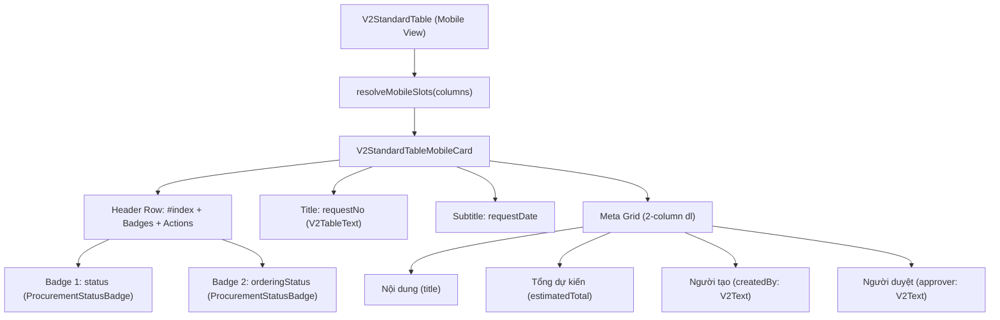

# Enhance Garage Procurement Requests Mobile Card: Kế Hoạch Triển Khai (erp-web)

Nâng cấp mobile card của danh sách Đề nghị mua hàng Garage (`garage-procurement-requests`): đưa badge "Tiến độ đặt" (`orderingStatus`) lên cạnh badge "Trạng thái" (`status`), đồng thời hiển thị 2 trường "Người tạo" (`createdBy`) và "Người duyệt" (`approver`) trong phần thông tin chi tiết (meta) của mobile card, tuân thủ triệt để chuẩn `/ui-structure`, V2 components và i18n.

Track: T2 (V2 Module & V2 Shared Table)
Structure: /ui-structure
Consistency Check: Đạt
Plane: KINDU-511 (Tasks: KINDU-512, KINDU-513, KINDU-514, KINDU-515)

---

## 📝 Spec

- **Mục tiêu**: Tối ưu hóa trải nghiệm xem đề nghị mua hàng trên thiết bị di động (mobile-first ergonomics): nắm bắt ngay trạng thái duyệt và tiến độ đặt hàng ở header thẻ, đồng thời tra cứu nhanh người tạo và người duyệt mà không cần mở drawer.
- **Phạm vi (In-Scope)**:
  - Nâng cấp `resolveMobileSlots` và `V2StandardTableMobileCard` trong `src/v2/shared/components/organisms/v2-standard-table/mobile/` để hỗ trợ hiển thị nhiều badge (`badges: V2Column<T>[]`) cạnh nhau thay vì chỉ 1 badge đơn lẻ, giữ tương thích ngược 100% với `badge?: V2Column<T>`.
  - Cập nhật cấu hình cột `buildProcurementRequestColumns` trong `src/v2/core/procurement/columns/procurementRequestColumns.tsx`:
    - `orderingStatus`: gán `mobileSlot: "badge"`.
    - `createdBy`: đổi từ `mobileSlot: "hidden"` sang `mobileSlot: "meta"`, hiển thị email bằng `V2Text`.
    - `approver`: đổi từ `mobileSlot: "hidden"` sang `mobileSlot: "meta"`, hiển thị email bằng `V2Text`.
  - Bổ sung unit tests cho `resolveMobileSlots`, mobile card và `buildProcurementRequestColumns`.
- **Ngoài phạm vi (Out-of-Scope)**:
  - Không thay đổi schema DB hay API backend (các field `createdByEmail`, `approverEmail`, `status`, `orderingStatus` đã có sẵn trong response API).
  - Không thay đổi giao diện Desktop table hoặc Drawer chi tiết.

### Tiêu chí chấp nhận (Acceptance Criteria)

- `AC-1`: Trên mobile card, badge "Tiến độ đặt" (`orderingStatus`) hiển thị dạng badge nằm ngay cạnh badge "Trạng thái" (`status`) ở hàng header (cạnh `#STT`).
- `AC-2`: Cột "Người tạo" (`createdBy`) hiển thị ở lưới meta 2 cột của mobile card với nhãn i18n `v2.procurement.columns.createdBy` và email định dạng bằng `V2Text`.
- `AC-3`: Cột "Người duyệt" (`approver`) hiển thị ở lưới meta 2 cột của mobile card với nhãn i18n `v2.procurement.columns.approver` và email định dạng bằng `V2Text`.
- `AC-4`: `V2StandardTable.mobile-slots` và `V2StandardTableMobileCard` hỗ trợ mảng `badges: V2Column<T>[]`, tương thích ngược hoàn toàn với các bảng đang dùng thuộc tính `badge?: V2Column<T>`.
- `AC-5`: Toàn bộ component tuân thủ chuẩn `/ui-structure`: dùng V2 Atomic atoms/molecules (`V2Text`, `ProcurementStatusBadge`), No Blue rule, token màu ngữ nghĩa, i18n chuẩn qua `t(...)`.
- `AC-6`: Các bộ unit test liên quan (`V2StandardTable.mobile-slots.test.ts`, `V2StandardTable.mobile.test.tsx`, `procurementColumns.test.tsx`) pass 100%.

### Ma trận truy vết AC → Task → Verification

| AC | Task | Verification Command (dưới 5s) |
| :--- | :--- | :--- |
| `AC-4` | `Task 2.1.1` | `bunx vitest run src/v2/shared/components/organisms/v2-standard-table/mobile/V2StandardTable.mobile-slots.test.ts` |
| `AC-1`, `AC-4`, `AC-5` | `Task 2.1.2` | `bunx vitest run src/v2/shared/components/organisms/v2-standard-table/mobile/V2StandardTable.mobile.test.tsx` |
| `AC-1`, `AC-2`, `AC-3`, `AC-5` | `Task 2.2.1` | `bunx vitest run src/v2/core/procurement/columns/procurementColumns.test.tsx` |
| `AC-6` | `Task 4.1.1` | `bunx tsc --noEmit` |

---

## ⚠️ User Review Required

1. **Hiển thị Người tạo & Người duyệt trên Mobile Card**:
   - Hiện tại dữ liệu từ API cung cấp `createdByEmail` và `approverEmail`. Chúng ta sẽ hiển thị trong khối `meta` dạng 2 cột (key-value):
     - **Người tạo**: `createdByEmail` hoặc `—` (dùng `V2Text` variant `body-sm`, màu `foreground` / `muted`).
     - **Người duyệt**: `approverEmail` hoặc `—` (dùng `V2Text` variant `body-sm`, màu `foreground` / `muted`).
   - Trên desktop table, 2 cột này vẫn giữ nguyên hiển thị và tính năng lọc cột như hiện tại.
2. **Khả năng hiển thị nhiều badge trên Mobile Header**:
   - Giải pháp mở rộng `V2MobileSlots`: thêm `badges: V2Column<T>[]` thu thập toàn bộ các cột có `mobileSlot === "badge"`. Nếu không có cột nào đánh dấu `badge`, tự động fallback về cột `status` như trước.
   - Giữ lại thuộc tính `badge?: V2Column<T>` trỏ về badge đầu tiên để đảm bảo tính tương thích ngược tuyệt đối (Zero Breaking Change).

---

## ❓ Open Questions

- Không có open questions chặn luồng. Giả định hiển thị email bằng `V2Text` gọn gàng phù hợp với diện tích `grid-cols-2` trên mobile.

---

## 🏛️ Thiết kế kỹ thuật

### Sơ đồ cấu trúc Mobile Card



### Chi tiết thay đổi hợp đồng & Type

```ts
// src/v2/shared/components/organisms/v2-standard-table/mobile/V2StandardTable.mobile-slots.ts
export interface V2MobileSlots<T> {
  title?: V2Column<T>;
  subtitle?: V2Column<T>;
  badge?: V2Column<T>;       // Giữ backward-compatibility
  badges: V2Column<T>[];      // Mảng tất cả badge cần render cạnh nhau
  meta: V2Column<T>[];
}
```

```tsx
// src/v2/core/procurement/columns/procurementRequestColumns.tsx
// orderingStatus:
{
  key: "orderingStatus",
  ...headerFilter.select(t("v2.procurement.columns.ordering", "Tiến độ đặt"), getOrderingStatusOptions(t)),
  size: 140,
  align: TableColumnAlign.CENTER,
  mobileSlot: "badge", // <-- Đưa lên cạnh status badge
  cell: (row) => <ProcurementStatusBadge value={row.orderingStatus} t={t} />,
}

// createdBy:
{
  key: "createdBy",
  ...headerFilter(t("v2.procurement.columns.createdBy", "Người tạo")),
  size: 140,
  mobileSlot: "meta", // <-- Đổi từ hidden sang meta
  cell: (row) => (
    <V2Text as="span" variant="body-sm" color={row.createdByEmail ? "default" : "muted"}>
      {row.createdByEmail ?? "—"}
    </V2Text>
  ),
}

// approver:
{
  key: "approver",
  ...headerFilter(t("v2.procurement.columns.approver", "Người duyệt")),
  size: 160,
  mobileSlot: "meta", // <-- Đổi từ hidden sang meta
  cell: (row) => (
    <V2Text as="span" variant="body-sm" color={row.approverEmail ? "default" : "muted"}>
      {row.approverEmail ?? "—"}
    </V2Text>
  ),
}
```

---

## 📋 Task Breakdown 3 Cấp & DoD

### Phase 2: Bảng & List Components

- [x] **Task 2.1.1: Mở rộng `resolveMobileSlots` hỗ trợ nhiều badge cạnh nhau**
  - **Phân hệ**: `Web` | **Ưu tiên**: `P0`
  - **Runner**: `Main Agent`
  - **Files**:
    - `[MODIFY]` [V2StandardTable.mobile-slots.ts](file:///home/dev/repos-dev-01/erp/erp-web/src/v2/shared/components/organisms/v2-standard-table/mobile/V2StandardTable.mobile-slots.ts)
    - `[MODIFY]` [V2StandardTable.mobile-slots.test.ts](file:///home/dev/repos-dev-01/erp/erp-web/src/v2/shared/components/organisms/v2-standard-table/mobile/V2StandardTable.mobile-slots.test.ts)
  - **DoD**:
    - `V2MobileSlots<T>` bổ sung `badges: V2Column<T>[]`.
    - `resolveMobileSlots` lọc toàn bộ cột có `mobileSlot === "badge"`. Nếu không có, fallback về cột `status`.
    - Các cột trong `badges` không bị lọt vào `meta`.
    - Unit tests kiểm thử đơn badge, đa badge và fallback pass 100%.
  - **Verification**: `bunx vitest run src/v2/shared/components/organisms/v2-standard-table/mobile/V2StandardTable.mobile-slots.test.ts`

- [x] **Task 2.1.2: Cập nhật `V2StandardTableMobileCard` render toàn bộ danh sách `badges`**
  - **Phân hệ**: `Web` | **Ưu tiên**: `P0`
  - **Runner**: `Main Agent`
  - **Files**:
    - `[MODIFY]` [V2StandardTable.mobile-card.tsx](file:///home/dev/repos-dev-01/erp/erp-web/src/v2/shared/components/organisms/v2-standard-table/mobile/V2StandardTable.mobile-card.tsx)
    - `[MODIFY]` [V2StandardTable.mobile.test.tsx](file:///home/dev/repos-dev-01/erp/erp-web/src/v2/shared/components/organisms/v2-standard-table/mobile/V2StandardTable.mobile.test.tsx)
  - **DoD**:
    - Header thẻ lặp qua `slots.badges` (hoặc fallback `slots.badge`) hiển thị các badge cách nhau `gap-1.5 flex-wrap`.
    - Unit tests cho rendering mobile card pass 100%.
  - **Verification**: `bunx vitest run src/v2/shared/components/organisms/v2-standard-table/mobile/V2StandardTable.mobile.test.tsx`

- [x] **Task 2.2.1: Cấu hình slot mobile cho cột Đề nghị mua hàng Garage**
  - **Phân hệ**: `Web` | **Ưu tiên**: `P0`
  - **Runner**: `Main Agent`
  - **Files**:
    - `[MODIFY]` [procurementRequestColumns.tsx](file:///home/dev/repos-dev-01/erp/erp-web/src/v2/core/procurement/columns/procurementRequestColumns.tsx)
    - `[MODIFY]` [procurementColumns.test.tsx](file:///home/dev/repos-dev-01/erp/erp-web/src/v2/core/procurement/columns/procurementColumns.test.tsx)
  - **DoD**:
    - Cột `orderingStatus` có `mobileSlot: "badge"`.
    - Cột `createdBy` có `mobileSlot: "meta"`, cell dùng `V2Text`.
    - Cột `approver` có `mobileSlot: "meta"`, cell dùng `V2Text`.
    - Giữ nguyên toàn bộ 9 cột cho desktop table.
    - Cập nhật test `buildProcurementRequestColumns` kiểm tra đúng `mobileSlot` cho từng cột.
  - **Verification**: `bunx vitest run src/v2/core/procurement/columns/procurementColumns.test.tsx`

### Phase 4: QC & Type Check

- [x] **Task 4.1.1: Type check & Regression verification toàn diện**
  - **Phân hệ**: `QC` | **Ưu tiên**: `P0`
  - **Runner**: `Main Agent`
  - **Files**: None
  - **DoD**:
    - `bunx tsc --noEmit` không có bất kỳ lỗi type nào.
    - Không ảnh hưởng tới các màn hình khác dùng `V2StandardTable`.
  - **Verification**: `bunx tsc --noEmit`

---

## ⏸️ Session Checkpoint
- **Active Task**: `None`
- **Tiến độ chi tiết**: Đã hoàn thành 100% (Task 2.1.1, Task 2.1.2, Task 2.2.1, Task 4.1.1)
- **Git Status**: Sẵn sàng commit
- **Hành động tiếp theo khi Resume**: Hoàn tất walkthrough và báo cáo nghiệm thu.

