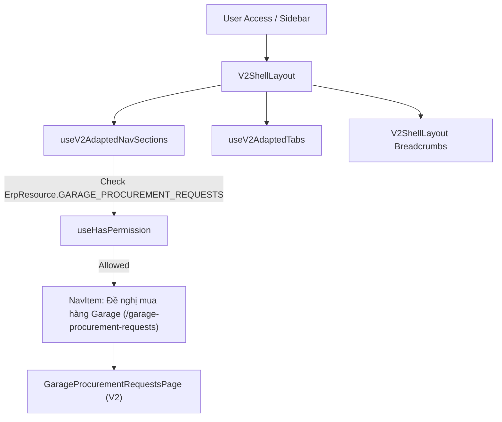

# Garage Procurement Requests: Tích hợp Sidebar Menu chính & Navigation (erp-web)

Bổ sung mục **"Đề nghị mua hàng Garage"** (`garage-procurement-requests`) vào thanh điều hướng Sidebar chính (`V2ShellLayout` / `useV2AdaptedNavSections`), Tab bar (`useV2AdaptedTabs`), Breadcrumb, Sidebar V1 dự phòng (`GarageNavSection`), và Bộ tìm kiếm nhanh toàn cục (`useNavItems`).

Track: T1 (Refactor / Tích hợp bổ sung vào shell navigation hiện hành)  
Structure: /ui-structure (Phần A/B Layout Navigation)  
Consistency Check: đạt  
Plane: KINDU-355 (Tasks KINDU-356..363)  

---

## 📝 Spec

- **Mục tiêu**: Đưa `garage-procurement-requests` xuất hiện trực tiếp, đồng bộ trên toàn bộ hệ thống điều hướng của giao diện chính (`erp-web`), đảm bảo người dùng có quyền `garage_procurement_requests:read` có thể truy cập dễ dàng từ Sidebar, Tab bar, Breadcrumbs và Search palette.
- **Phạm vi (In-Scope)**:
  - Adapter `useV2AdaptedNavSections.ts` và test `useV2AdaptedNavSections.test.ts`.
  - Tab manager `useV2AdaptedTabs.ts` (icon `ClipboardList` + label).
  - Breadcrumbs `V2ShellLayout.tsx`.
  - Sidebar V1 `GarageNavSection.tsx`, `GarageNavSection.hook.ts` và test `GarageNavSection.test.tsx`.
  - Search palette `useNavItems.tsx`.
  - Locale nav `vi.ts` / `en.ts` trong `src/core/locale/system/nav/`.
- **Ngoài phạm vi (Out-of-Scope)**: Không thay đổi backend API (API đã có sẵn tại `/api/v2/garage-procurement-requests`), không sửa cấu trúc nội bộ của module trang `GarageProcurementRequestsPage.tsx`.
- **Tiêu chí chấp nhận (Acceptance Criteria)**:
  - **AC-1**: Khi người dùng có quyền `garage_procurement_requests:read`, mục "Đề nghị mua hàng Garage" xuất hiện trong khối GARAGE trên Sidebar chính với icon `ClipboardList` và đường dẫn `/garage-procurement-requests`.
  - **AC-2**: Mở trang `/garage-procurement-requests` hiển thị đúng tiêu đề tab "Đề nghị mua hàng Garage" và icon `ClipboardList` trên Tab bar `V2ShellLayout`.
  - **AC-3**: Breadcrumbs hiển thị đúng `Garage > Đề nghị mua hàng Garage`.
  - **AC-4**: Sidebar V1 (`GarageNavSection`) hiển thị NavItem tương ứng và highlight active khi đang ở trang này.
  - **AC-5**: Bộ tìm kiếm nhanh toàn cục (`useNavItems`) trả về kết quả khi gõ từ khóa `"de nghi mua hang garage"`, `"pr garage"`, `"phu tung"`.
  - **AC-6**: Toàn bộ unit tests liên quan pass 100% (`vitest related`), `bunx tsc --noEmit` không có lỗi.

### Bảng truy vết AC ➔ Task ➔ Verification
| AC | Task | Verification |
| :--- | :--- | :--- |
| `AC-1` | 2.1.1, 2.1.2 | `bunx vitest run src/core/components/layout/adapters/__tests__/useV2AdaptedNavSections.test.ts` |
| `AC-2` | 2.2.1 | `bunx tsc --noEmit` |
| `AC-3` | 2.2.2 | `bunx tsc --noEmit` |
| `AC-4` | 3.1.1, 3.1.2 | `bunx vitest run src/core/components/layout/sidebar/components/garage-nav-section/GarageNavSection.test.tsx` |
| `AC-5` | 3.2.1 | `bunx tsc --noEmit` |
| `AC-6` | 4.1.1 | `bunx vitest related src/core/components/layout/adapters/useV2AdaptedNavSections.ts src/core/components/layout/adapters/useV2AdaptedTabs.ts src/core/components/layout/sidebar/components/garage-nav-section/GarageNavSection.tsx src/core/components/layout/hooks/useNavItems.tsx --run` |

---

## ⚠️ User Review Required
> - **Thứ tự hiển thị trên Sidebar menu GARAGE**: Đã xếp theo luồng nghiệp vụ mua hàng:
>   1. `Hoạt động garage` (`garage-cases`)
>   2. **`Đề nghị mua hàng Garage` (`garage-procurement-requests`)** *(Mới)*
>   3. `Đơn mua hàng Garage` (`garage-procurement-orders`)
>   4. `Nhập kho Garage` (`garage-goods-receipts`)
>   5. `Thu chi garage` (`garage-cashflow`)
>   6. `Công nợ garage` (`garage-debts`)
>   7. `Chi phí vận hành Garage` (`garage-opex`)
> - **Quyền hạn**: Menu yêu cầu quyền `garage_procurement_requests:read`.

---

## ❓ Open Questions
- Không có câu hỏi còn vướng mắc. Toàn bộ types, icons và routes đều đã sẵn sàng trong codebase.

---

## 🏛️ Thiết kế kỹ thuật

- **Icon**: Dùng `ClipboardList` đồng nhất từ `lucide-react` (khớp với cấu hình V2 hiện tại trong `v2Navigation.config.ts`).
- **Translation keys**: `nav.items.garageProcurementRequests` (fallback: `"Đề nghị mua hàng Garage"` / `"Garage Purchase Requests"`).

---

## 📋 Task Breakdown 3 Cấp & DoD

### Phase 2 – Bảng, Adapter & List Integration (erp-web)
- [x] **Task 2.1.1: Tích hợp `garage-procurement-requests` vào `useV2AdaptedNavSections`**
  - **Phân hệ**: `Web` | **Ưu tiên**: `P0`
  - **Runner**: `Main Agent`
  - **Files**: `[MODIFY]` [erp/erp-web/src/core/components/layout/adapters/useV2AdaptedNavSections.ts](file:///home/dev/repos-dev-01/erp/erp-web/src/core/components/layout/adapters/useV2AdaptedNavSections.ts)
  - **DoD**: Bổ sung `canReadGarageProcurementRequests = useHasPermission(ErpResource.GARAGE_PROCUREMENT_REQUESTS, ErpAction.READ)` và push item vào `sec-garage` ngay trước `garage-procurement-orders`.
  - **Verification**: `bunx tsc --noEmit`
- [x] **Task 2.1.2: Bổ sung Unit Test cho `useV2AdaptedNavSections`**
  - **Phân hệ**: `Web` | **Ưu tiên**: `P0`
  - **Runner**: `Main Agent`
  - **Files**: `[MODIFY]` [erp/erp-web/src/core/components/layout/adapters/__tests__/useV2AdaptedNavSections.test.ts](file:///home/dev/repos-dev-01/erp/erp-web/src/core/components/layout/adapters/__tests__/useV2AdaptedNavSections.test.ts)
  - **DoD**: Thêm test suite kiểm tra có item khi có quyền và không có khi thiếu quyền.
  - **Verification**: `bunx vitest run src/core/components/layout/adapters/__tests__/useV2AdaptedNavSections.test.ts`
- [x] **Task 2.2.1: Bổ sung Tab Resolver & Icon trong `useV2AdaptedTabs`**
  - **Phân hệ**: `Web` | **Ưu tiên**: `P1`
  - **Runner**: `Main Agent`
  - **Files**: `[MODIFY]` [erp/erp-web/src/core/components/layout/adapters/useV2AdaptedTabs.ts](file:///home/dev/repos-dev-01/erp/erp-web/src/core/components/layout/adapters/useV2AdaptedTabs.ts)
  - **DoD**: Map `garage-procurement-requests` vào `TAB_ICONS` (`ClipboardList`) và `tabLabel`.
  - **Verification**: `bunx tsc --noEmit`
- [x] **Task 2.2.2: Bổ sung Breadcrumb trong `V2ShellLayout`**
  - **Phân hệ**: `Web` | **Ưu tiên**: `P1`
  - **Runner**: `Main Agent`
  - **Files**: `[MODIFY]` [erp/erp-web/src/core/components/layout/V2ShellLayout.tsx](file:///home/dev/repos-dev-01/erp/erp-web/src/core/components/layout/V2ShellLayout.tsx)
  - **DoD**: Thêm `case "garage-procurement-requests"` trả về breadcrumbs `[Garage, Đề nghị mua hàng Garage]`.
  - **Verification**: `bunx tsc --noEmit`

### Phase 3 – V1 Sidebar Fallback & Global Search (erp-web)
- [x] **Task 3.1.1: Bổ sung NavItem vào `GarageNavSection` (V1)**
  - **Phân hệ**: `Web` | **Ưu tiên**: `P2`
  - **Runner**: `Main Agent`
  - **Files**: `[MODIFY]` [erp/erp-web/src/core/components/layout/sidebar/components/garage-nav-section/GarageNavSection.hook.ts](file:///home/dev/repos-dev-01/erp/erp-web/src/core/components/layout/sidebar/components/garage-nav-section/GarageNavSection.hook.ts), [erp/erp-web/src/core/components/layout/sidebar/components/garage-nav-section/GarageNavSection.tsx](file:///home/dev/repos-dev-01/erp/erp-web/src/core/components/layout/sidebar/components/garage-nav-section/GarageNavSection.tsx)
  - **DoD**: Thêm hook permission `canReadGarageProcurementRequests`, active state, handleNav và NavItem trong sidebar V1.
  - **Verification**: `bunx tsc --noEmit`
- [x] **Task 3.1.2: Cập nhật Unit Test cho `GarageNavSection`**
  - **Phân hệ**: `Web` | **Ưu tiên**: `P2`
  - **Runner**: `Main Agent`
  - **Files**: `[MODIFY]` [erp/erp-web/src/core/components/layout/sidebar/components/garage-nav-section/GarageNavSection.test.tsx](file:///home/dev/repos-dev-01/erp/erp-web/src/core/components/layout/sidebar/components/garage-nav-section/GarageNavSection.test.tsx)
  - **DoD**: Test quyền và active state cho `garage-procurement-requests`.
  - **Verification**: `bunx vitest run src/core/components/layout/sidebar/components/garage-nav-section/GarageNavSection.test.tsx`
- [x] **Task 3.2.1: Tích hợp `garage-procurement-requests` vào bộ tìm kiếm `useNavItems`**
  - **Phân hệ**: `Web` | **Ưu tiên**: `P2`
  - **Runner**: `Main Agent`
  - **Files**: `[MODIFY]` [erp/erp-web/src/core/components/layout/hooks/useNavItems.tsx](file:///home/dev/repos-dev-01/erp/erp-web/src/core/components/layout/hooks/useNavItems.tsx), [erp/erp-web/src/core/locale/system/nav/vi.ts](file:///home/dev/repos-dev-01/erp/erp-web/src/core/locale/system/nav/vi.ts), [erp/erp-web/src/core/locale/system/nav/en.ts](file:///home/dev/repos-dev-01/erp/erp-web/src/core/locale/system/nav/en.ts)
  - **DoD**: Bổ sung translation key `garageProcurementRequests` và search item với các từ khóa tra cứu tiếng Việt / không dấu.
  - **Verification**: `bunx tsc --noEmit`

### Phase 4 – QC & Verification (erp-web)
- [x] **Task 4.1.1: Chạy Scoped Tests & Typecheck tổng thể**
  - **Phân hệ**: `Web` | **Ưu tiên**: `P0`
  - **Runner**: `Main Agent`
  - **Files**: N/A
  - **DoD**: Chạy các file spec liên quan pass 100%, typecheck sạch sẽ.
  - **Verification**: `cd /home/dev/repos-dev-01/erp/erp-web && bunx vitest related src/core/components/layout/adapters/useV2AdaptedNavSections.ts src/core/components/layout/adapters/useV2AdaptedTabs.ts src/core/components/layout/sidebar/components/garage-nav-section/GarageNavSection.tsx src/core/components/layout/hooks/useNavItems.tsx --run && bun run type:check`

---

## ⏸️ Session Checkpoint
- **Active Task**: `None`
- **Tiến độ chi tiết**: Đã hoàn thành 100% các task theo kế hoạch (Task 2.1.1, 2.1.2, 2.2.1, 2.2.2, 3.1.1, 3.1.2, 3.2.1, 4.1.1). Toàn bộ tests pass, typecheck sạch, đã cập nhật Plane KINDU-355..363 -> Done.
- **Hành động tiếp theo khi Resume**: Sẵn sàng commit và review cùng User.
