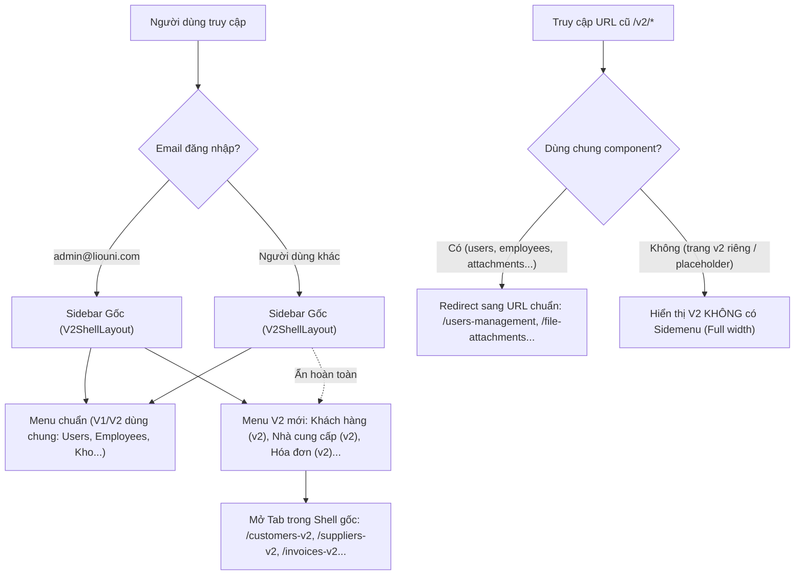

# Implementation Plan - Đồng bộ hóa Route, URL và Sidebar giữa V1 & V2

> **Giao thức**: `/erp-plan` (Phase 1 Discovery $\rightarrow$ Phase 2 Thiết kế $\rightarrow$ Phase 3 Task 3 Cấp $\rightarrow$ Phase 4 Approval Gate).  
> **Track**: `T1` (Refactor / Tích hợp V2-ready vào shell chính)  
> **Repo đích**: `erp/erp-web` (Branch: `erp-master`)  
> **Structure**: `/erp-ui-structure`

---

## 1. Goal Description

Hệ thống ERP hiện đang tồn tại hai cơ chế routing song song:
1. **Shell chính (`/*`)**: V1 Multi-tab Shell (`V2ShellLayout`) quản lý qua `useAppStore`, đồng bộ 2 chiều bằng `pageUrl.ts`.
2. **Khu vực `/v2/*`**: Router nhẹ riêng (`V2RouterView`), tự hiển thị sidebar riêng (`V2Sidebar` trong `V2AppLayout` và `V2AdminLayout`).

Hiện trạng phát sinh 2 vấn đề lớn:
- Nhiều module đã được đưa vào shell chính và dùng chung 1 component với V2 (ví dụ `users-management`, `employees-management`, `file-attachments`, `garage-stock-vouchers`, `garage-stock-balances`, `garage-procurement`, `loans`, `permission`), nhưng vẫn duy trì URL song song dạng `/v2/<module>` gây phân mảnh điều hướng.
- Một số module V2 đã được viết mới khác biệt hoàn toàn so với component V1 cũ (`customers`, `suppliers`, `invoices`, `audit-logs`, `admin-dashboard`), nhưng lại bị "cô lập" bên trong `/v2/*` với thanh sidemenu riêng biệt, người dùng thông thường và quản trị viên không thể trải nghiệm liền mạch từ sidebar gốc.

**Mục tiêu của task**:
1. **Loại bỏ URL `/v2/*` cho các module dùng chung component**: Với các trang đã dùng chung 1 component duy nhất giữa `/*` và `/v2/*`, xóa URL `/v2/*` trong cấu hình route và thiết lập redirect tự động về URL chính thức `/<slug>`.
2. **Đưa các component V2 khác biệt lên Sidebar Menu Gốc**:
   - Đối với các phân hệ có 2 component khác nhau (`customers`, `suppliers`, `invoices`, `audit-logs`, `admin-dashboard`), đăng ký các route/pageKey mới trên shell gốc (`customers-v2`, `suppliers-v2`, `invoices-v2`, `audit-logs-v2`, `admin-dashboard-v2`).
   - Hiển thị các menu item này trực tiếp trong **Sidebar Menu Gốc** (`V2ShellLayout`), kèm hậu tố ` (v2)` trong nhãn (ví dụ: *"Khách hàng (v2)"*, *"Nhà cung cấp (v2)"*, *"Hóa đơn điện tử (v2)"*, *"Nhật ký hoạt động (v2)"*).
   - **Bảo mật truy cập**: **CHỈ duy nhất tài khoản `admin@liouni.com`** mới nhìn thấy và truy cập được các menu item `(v2)` này.
3. **Xóa hoàn toàn Sidemenu trong URL `/v2/*`**:
   - Loại bỏ `V2Sidebar` và drawer điều hướng mobile trong `V2AppLayout` và `V2AdminLayout`. Nếu người dùng truy cập trực tiếp URL `/v2/*`, nội dung trang (hoặc topbar/right-panel) sẽ chiếm toàn bộ không gian (full width), không còn sidemenu dư thừa.

---

## 2. Mermaid Diagram - Luồng Điều Hướng Mới



---

## 3. User Review Required

> [!IMPORTANT]
> **Quy ước đặt tên URL và PageKey**:
> - Các module V2 khác biệt khi gắn vào shell gốc sẽ có PageKey: `customers-v2`, `suppliers-v2`, `invoices-v2`, `audit-logs-v2`, `admin-dashboard-v2`.
> - URL tương ứng trên trình duyệt: `/customers-v2`, `/suppliers-v2`, `/invoices-v2`, `/audit-logs-v2`, `/admin-dashboard-v2` (tuân thủ nguyên tắc không có tiền tố `/v2/` lồng trong shell).

> [!NOTE]
> **Phân quyền nghiêm ngặt**:
> - Menu item `(v2)` chỉ hiển thị trong sidebar gốc khi `employee?.email === "admin@liouni.com"`.
> - Tại tầng Page Guard của `App.tsx`, nếu người dùng không phải `admin@liouni.com` mà gõ trực tiếp URL `/customers-v2`, hệ thống sẽ trả về `<NotFound />` hoặc từ chối truy cập.

---

## 4. Proposed Changes

### Component 1: Định nghĩa Types và URL Mapping (`shared/types`, `shared/utils`)

#### [MODIFY] [erp/erp-web/src/shared/types/index.ts](file:///home/dev/repos-dev-02/erp/erp-web/src/shared/types/index.ts)
- Bổ sung các `PageKey` mới vào union type `PageKey`:
  ```ts
  | "customers-v2"
  | "suppliers-v2"
  | "invoices-v2"
  | "audit-logs-v2"
  | "admin-dashboard-v2"
  ```

#### [MODIFY] [erp/erp-web/src/shared/utils/pageUrl.ts](file:///home/dev/repos-dev-02/erp/erp-web/src/shared/utils/pageUrl.ts)
- Bổ sung các key mới vào `ALL_PAGE_KEYS`.
- Cập nhật `pageToPath` để tạo đường dẫn sạch:
  - `customers-v2` $\rightarrow$ `/customers-v2`
  - `suppliers-v2` $\rightarrow$ `/suppliers-v2`
  - `invoices-v2` $\rightarrow$ `/invoices-v2`
  - `audit-logs-v2` $\rightarrow$ `/audit-logs-v2`
  - `admin-dashboard-v2` $\rightarrow$ `/admin-dashboard-v2`
- Trong `pathToPage`: nhận diện và parse đúng các slug trên.

---

### Component 2: Đăng ký Component và Redirection trong Root Shell (`App.tsx`)

#### [MODIFY] [erp/erp-web/src/App.tsx](file:///home/dev/repos-dev-02/erp/erp-web/src/App.tsx)
- Lazy load các component V2:
  ```ts
  const BusinessPartnersCustomersV2Page = lazy(() =>
    import("@/v2/modules/business-partners-customers").then((m) => ({
      default: m.BusinessPartnersCustomersPage,
    })),
  );
  const BusinessPartnersSuppliersV2Page = lazy(() =>
    import("@/v2/modules/business-partners-suppliers").then((m) => ({
      default: m.BusinessPartnersSuppliersPage,
    })),
  );
  const InvoicesV2Page = lazy(() =>
    import("@/v2/modules/finance-invoice").then((m) => ({
      default: m.InvoiceShapePage,
    })),
  );
  const AuditLogsV2Page = lazy(() =>
    import("@/v2/modules/audit-logs").then((m) => ({
      default: m.AuditLogsGuarded,
    })),
  );
  const AdminDashboardV2Page = lazy(() =>
    import("@/v2/modules/admin-dashboard").then((m) => ({
      default: m.V2AdminDashboardPage,
    })),
  );
  ```
- Đăng ký vào bảng `PAGE_COMPONENTS`:
  ```ts
  "customers-v2": BusinessPartnersCustomersV2Page,
  "suppliers-v2": BusinessPartnersSuppliersV2Page,
  "invoices-v2": InvoicesV2Page,
  "audit-logs-v2": AuditLogsV2Page,
  "admin-dashboard-v2": AdminDashboardV2Page,
  ```
- Tại hook đồng bộ URL (`useEffect` popstate / initial sync):
  - Bổ sung bảng redirect tự động cho các route `/v2/*` dùng chung component:
    - `/v2/users-management`, `/v2/admin/users` $\rightarrow$ `/users-management`
    - `/v2/employees-management` $\rightarrow$ `/employees-management`
    - `/v2/file-attachments-management` $\rightarrow$ `/file-attachments`
    - `/v2/garage-stock-vouchers`, `/v2/garage-goods-receipts` $\rightarrow$ `/garage-stock-vouchers`
    - `/v2/garage-stock-balances` $\rightarrow$ `/garage-stock-balances`
    - `/v2/garage-procurement` $\rightarrow$ `/garage-procurement`
    - `/v2/loans` $\rightarrow$ `/loans-tool`
    - `/v2/permission`, `/v2/erp-permissions-core` $\rightarrow$ `/permission`
  - Nếu là tài khoản `admin@liouni.com` truy cập `/v2/customers`, `/v2/suppliers`, `/v2/invoices`, `/v2/admin/audit-logs`, `/v2/admin/dashboard` $\rightarrow$ redirect về URL tương ứng trong shell gốc (`/customers-v2`, `/suppliers-v2`, `/invoices-v2`, `/audit-logs-v2`, `/admin-dashboard-v2`).

---

### Component 3: Sidebar Menu Gốc và Tabs (`core/components/layout`)

#### [MODIFY] [erp/erp-web/src/core/components/layout/adapters/useV2AdaptedNavSections.ts](file:///home/dev/repos-dev-02/erp/erp-web/src/core/components/layout/adapters/useV2AdaptedNavSections.ts)
- Kiểm tra cờ `isAdminEmail = employee?.email === "admin@liouni.com"`.
- Nếu `isAdminEmail`:
  - Thêm item *"Khách hàng (v2)"* vào `sec-sales` (`id: "customers-v2"`, `href: "/customers-v2"`).
  - Thêm item *"Nhà cung cấp (v2)"* vào `sec-purchasing` (`id: "suppliers-v2"`, `href: "/suppliers-v2"`).
  - Thêm item *"Hóa đơn điện tử (v2)"* vào `sec-accounting` (`id: "invoices-v2"`, `href: "/invoices-v2"`).
  - Thêm item *"Nhật ký hoạt động (v2)"* vào `sec-settings` (`id: "audit-logs-v2"`, `href: "/audit-logs-v2"`).
  - Thêm item *"Tổng quan Quản trị (v2)"* vào `sec-settings` hoặc `sec-dashboard` (`id: "admin-dashboard-v2"`, `href: "/admin-dashboard-v2"`).

#### [MODIFY] [erp/erp-web/src/core/components/layout/V2ShellLayout.tsx](file:///home/dev/repos-dev-02/erp/erp-web/src/core/components/layout/V2ShellLayout.tsx)
- Thêm breadcrumbs resolver cho các pageKey `(v2)`.

#### [MODIFY] [erp/erp-web/src/core/components/layout/adapters/useV2AdaptedTabs.ts](file:///home/dev/repos-dev-02/erp/erp-web/src/core/components/layout/adapters/useV2AdaptedTabs.ts)
- Thêm `TAB_ICONS` và nhãn `tabLabel` cho các pageKey `(v2)`:
  - `customers-v2` $\rightarrow$ "Khách hàng (v2)"
  - `suppliers-v2` $\rightarrow$ "Nhà cung cấp (v2)"
  - `invoices-v2` $\rightarrow$ "Hóa đơn điện tử (v2)"
  - `audit-logs-v2` $\rightarrow$ "Nhật ký hoạt động (v2)"
  - `admin-dashboard-v2` $\rightarrow$ "Tổng quan Quản trị (v2)"

#### [MODIFY] [erp/erp-web/src/core/locale/system/nav/vi.ts](file:///home/dev/repos-dev-02/erp/erp-web/src/core/locale/system/nav/vi.ts) & [en.ts](file:///home/dev/repos-dev-02/erp/erp-web/src/core/locale/system/nav/en.ts)
- Bổ sung translation keys cho các nhãn `(v2)` trên cả tiếng Việt và tiếng Anh.

---

### Component 4: Xóa Sidemenu trong `/v2/*` Layouts & Dọn dẹp Route Config

#### [MODIFY] [erp/erp-web/src/v2/app/router/v2RouteConfig.ts](file:///home/dev/repos-dev-02/erp/erp-web/src/v2/app/router/v2RouteConfig.ts)
- Xóa các route trùng lặp dùng chung component:
  - Bỏ `/v2/users-management`, `/v2/admin/users`
  - Bỏ `/v2/employees-management`
  - Bỏ `/v2/file-attachments-management`
  - Bỏ `/v2/garage-stock-vouchers`, `/v2/garage-goods-receipts`
  - Bỏ `/v2/garage-stock-balances`
  - Bỏ `/v2/garage-procurement`
  - Bỏ `/v2/loans`
  - Bỏ `/v2/permission`, `/v2/erp-permissions-core`

#### [MODIFY] [erp/erp-web/src/v2/app/layouts/v2-app-layout/V2AppLayout.desktop.tsx](file:///home/dev/repos-dev-02/erp/erp-web/src/v2/app/layouts/v2-app-layout/V2AppLayout.desktop.tsx) & [V2AppLayout.mobile.tsx](file:///home/dev/repos-dev-02/erp/erp-web/src/v2/app/layouts/v2-app-layout/V2AppLayout.mobile.tsx)
- Loại bỏ `<V2Sidebar ... />` khỏi layout desktop, để `V2RightPanel` chiếm trọn 100% bề ngang.
- Loại bỏ thanh điều hướng mobile (`V2BottomNav`, drawer danh mục menu) khỏi layout mobile.

#### [MODIFY] [erp/erp-web/src/v2/app/layouts/v2-admin-layout/V2AdminLayout.desktop.tsx](file:///home/dev/repos-dev-02/erp/erp-web/src/v2/app/layouts/v2-admin-layout/V2AdminLayout.desktop.tsx) & [V2AdminLayout.mobile.tsx](file:///home/dev/repos-dev-02/erp/erp-web/src/v2/app/layouts/v2-admin-layout/V2AdminLayout.mobile.tsx)
- Loại bỏ `<V2Sidebar ... />` khỏi `V2AdminLayoutDesktop`.
- Loại bỏ drawer điều hướng mobile khỏi `V2AdminLayoutMobile`.

---

## 5. Task Breakdown 3 Cấp (X.Y.Z)

### Phase 3 — Web UI Implementation

- [ ] **Task 3.1.1: Bổ sung PageKey và cấu hình URL cho các phân hệ V2 khác biệt**
  - **Phân hệ**: `Web` | **Ưu tiên**: `P0`
  - **Runner**: `Main Agent`
  - **Files**: `[MODIFY]` [erp/erp-web/src/shared/types/index.ts](file:///home/dev/repos-dev-02/erp/erp-web/src/shared/types/index.ts), `[MODIFY]` [erp/erp-web/src/shared/utils/pageUrl.ts](file:///home/dev/repos-dev-02/erp/erp-web/src/shared/utils/pageUrl.ts)
  - **DoD**: Khai báo đủ 5 PageKey mới (`customers-v2`, `suppliers-v2`, `invoices-v2`, `audit-logs-v2`, `admin-dashboard-v2`), `pageToPath` và `pathToPage` ánh xạ 2 chiều chuẩn xác.
  - **Verification**: `bunx vitest run src/shared/utils/pageUrl.test.ts` (hoặc kiểm tra type-check cho `pageUrl.ts`).

- [ ] **Task 3.1.2: Bổ sung từ điển i18n cho các menu item (v2)**
  - **Phân hệ**: `Web` | **Ưu tiên**: `P1`
  - **Runner**: `Main Agent`
  - **Files**: `[MODIFY]` [erp/erp-web/src/core/locale/system/nav/vi.ts](file:///home/dev/repos-dev-02/erp/erp-web/src/core/locale/system/nav/vi.ts), `[MODIFY]` [erp/erp-web/src/core/locale/system/nav/en.ts](file:///home/dev/repos-dev-02/erp/erp-web/src/core/locale/system/nav/en.ts)
  - **DoD**: Có đầy đủ key cho tiếng Việt và tiếng Anh kèm hậu tố `(v2)` rõ ràng.
  - **Verification**: `bun run type:check`

- [ ] **Task 3.2.1: Hiển thị các menu item (v2) trên Sidebar Menu Gốc chỉ cho admin@liouni.com**
  - **Phân hệ**: `Web` | **Ưu tiên**: `P0`
  - **Runner**: `Main Agent`
  - **Files**: `[MODIFY]` [erp/erp-web/src/core/components/layout/adapters/useV2AdaptedNavSections.ts](file:///home/dev/repos-dev-02/erp/erp-web/src/core/components/layout/adapters/useV2AdaptedNavSections.ts)
  - **DoD**: Chỉ khi `employee?.email === "admin@liouni.com"`, các mục `customers-v2`, `suppliers-v2`, `invoices-v2`, `audit-logs-v2`, `admin-dashboard-v2` mới xuất hiện trong các sections tương ứng. Người dùng khác không thấy.
  - **Verification**: `bunx vitest run src/core/components/layout/adapters/__tests__/useV2AdaptedNavSections.test.ts`

- [ ] **Task 3.2.2: Tích hợp Breadcrumbs và Tabs cho các trang (v2) trong Shell gốc**
  - **Phân hệ**: `Web` | **Ưu tiên**: `P1`
  - **Runner**: `Main Agent`
  - **Files**: `[MODIFY]` [erp/erp-web/src/core/components/layout/V2ShellLayout.tsx](file:///home/dev/repos-dev-02/erp/erp-web/src/core/components/layout/V2ShellLayout.tsx), `[MODIFY]` [erp/erp-web/src/core/components/layout/adapters/useV2AdaptedTabs.ts](file:///home/dev/repos-dev-02/erp/erp-web/src/core/components/layout/adapters/useV2AdaptedTabs.ts)
  - **DoD**: Mở tab hiển thị đúng tiêu đề kèm `(v2)`, icon tương ứng, và breadcrumbs chính xác.
  - **Verification**: `bun run type:check`

- [ ] **Task 3.3.1: Đăng ký Page Components và thiết lập Redirection URL trong App.tsx**
  - **Phân hệ**: `Web` | **Ưu tiên**: `P0`
  - **Runner**: `Main Agent`
  - **Files**: `[MODIFY]` [erp/erp-web/src/App.tsx](file:///home/dev/repos-dev-02/erp/erp-web/src/App.tsx)
  - **DoD**: 
    1. `PAGE_COMPONENTS` chứa 5 page V2 mới.
    2. URL sync hook tự động redirect các URL `/v2/*` trùng component về URL gốc `/*`.
    3. Bảo vệ các trang `/v2` mới: người dùng không phải `admin@liouni.com` khi vào thẳng URL sẽ bị từ chối hoặc trả về NotFound.
  - **Verification**: `bun run type:check`

- [ ] **Task 3.4.1: Xóa bỏ sidemenu trong layouts của /v2/* (V2AppLayout & V2AdminLayout)**
  - **Phân hệ**: `Web` | **Ưu tiên**: `P0`
  - **Runner**: `Main Agent`
  - **Files**: 
    - `[MODIFY]` [erp/erp-web/src/v2/app/layouts/v2-app-layout/V2AppLayout.desktop.tsx](file:///home/dev/repos-dev-02/erp/erp-web/src/v2/app/layouts/v2-app-layout/V2AppLayout.desktop.tsx)
    - `[MODIFY]` [erp/erp-web/src/v2/app/layouts/v2-app-layout/V2AppLayout.mobile.tsx](file:///home/dev/repos-dev-02/erp/erp-web/src/v2/app/layouts/v2-app-layout/V2AppLayout.mobile.tsx)
    - `[MODIFY]` [erp/erp-web/src/v2/app/layouts/v2-admin-layout/V2AdminLayout.desktop.tsx](file:///home/dev/repos-dev-02/erp/erp-web/src/v2/app/layouts/v2-admin-layout/V2AdminLayout.desktop.tsx)
    - `[MODIFY]` [erp/erp-web/src/v2/app/layouts/v2-admin-layout/V2AdminLayout.mobile.tsx](file:///home/dev/repos-dev-02/erp/erp-web/src/v2/app/layouts/v2-admin-layout/V2AdminLayout.mobile.tsx)
  - **DoD**: Không còn render `V2Sidebar` hay bottom nav menu trong các layout của `/v2/*`. Nội dung trang mở rộng toàn màn hình.
  - **Verification**: `bunx vitest run src/v2/app/layouts/v2-admin-layout/V2AdminLayout.test.tsx`

- [ ] **Task 3.4.2: Dọn dẹp cấu hình route V2 và cập nhật test suites**
  - **Phân hệ**: `Web` | **Ưu tiên**: `P1`
  - **Runner**: `Main Agent`
  - **Files**: 
    - `[MODIFY]` [erp/erp-web/src/v2/app/router/v2RouteConfig.ts](file:///home/dev/repos-dev-02/erp/erp-web/src/v2/app/router/v2RouteConfig.ts)
    - `[MODIFY]` [erp/erp-web/src/v2/app/router/v2RouteConfig.test.ts](file:///home/dev/repos-dev-02/erp/erp-web/src/v2/app/router/v2RouteConfig.test.ts)
  - **DoD**: Loại bỏ các route `/v2/*` trùng component; cập nhật các unit test khớp với cấu hình mới.
  - **Verification**: `bunx vitest run src/v2/app/router/v2RouteConfig.test.ts`

---

### Phase 4 — Quality Control & Verification

- [ ] **Task 4.1.1: Chạy kiểm thử tự động toàn diện và Type Check**
  - **Phân hệ**: `QC` | **Ưu tiên**: `P0`
  - **Runner**: `Main Agent`
  - **Files**: Toàn bộ files đã sửa
  - **DoD**: `bun run type:check` không lỗi, các unit tests liên quan pass 100%.
  - **Verification**: `cd erp/erp-web && bun run type:check && bun run test`

---

## 6. Verification Plan

### Automated Tests
1. **Type checking**:
   ```bash
   cd erp/erp-web && bun run type:check
   ```
2. **Unit tests cho Sidebar Sections**:
   ```bash
   cd erp/erp-web && bunx vitest run src/core/components/layout/adapters/__tests__/useV2AdaptedNavSections.test.ts
   ```
3. **Unit tests cho V2 Route Config & Layouts**:
   ```bash
   cd erp/erp-web && bunx vitest run src/v2/app/router/v2RouteConfig.test.ts src/v2/app/layouts/v2-admin-layout/V2AdminLayout.test.tsx
   ```

### Manual Verification
1. Đăng nhập với tài khoản `admin@liouni.com`:
   - Kiểm tra Sidebar gốc thấy các mục: *"Khách hàng (v2)"*, *"Nhà cung cấp (v2)"*, *"Hóa đơn điện tử (v2)"*, *"Nhật ký hoạt động (v2)"*.
   - Bấm vào từng mục: tab mới mở ra, URL hiển thị `/customers-v2`, `/suppliers-v2`, v.v... và render đúng giao diện V2 bên trong shell chính.
2. Đăng nhập với tài khoản người dùng thông thường (không phải `admin@liouni.com`):
   - Kiểm tra Sidebar gốc: **hoàn toàn KHÔNG** hiển thị bất kỳ menu item `(v2)` nào.
   - Thử nhập URL `/customers-v2`: bị chặn hoặc trả về NotFound.
3. Thử truy cập các URL `/v2/*` cũ dùng chung component (ví dụ `/v2/users-management`, `/v2/garage-stock-vouchers`):
   - Hệ thống tự động redirect về URL chuẩn `/users-management`, `/garage-stock-vouchers`.
4. Truy cập một trang `/v2/*` bất kỳ (ví dụ `/v2/sales-orders`):
   - Xác nhận: **không còn hiển thị sidemenu** ở bên trái; nội dung mở rộng full chiều rộng.
