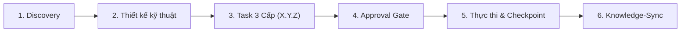
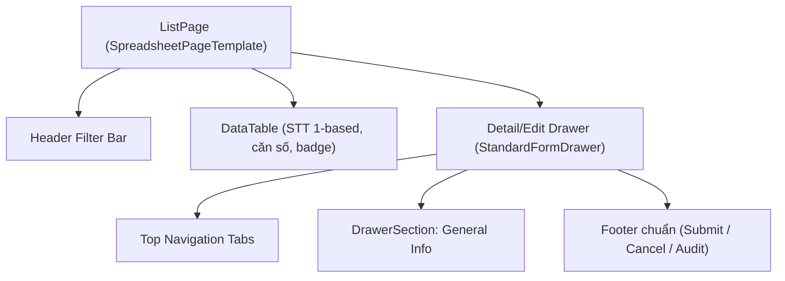

# 📋 `/erp-plan` — erp-web

<!-- SHARED:BEGIN erp-plan -->
Áp dụng cho mọi task ERP. Phần cuối file là phụ lục đặc thù của repo; khi có mâu thuẫn, phụ lục thắng cho repo đó.

---

## 🎯 6 Nguyên Tắc Cốt Lõi



1. **Plan-First (Read-Only & Zero Execution)**: không sửa code và **không chạy test runner, build hay check** khi chưa có `OK`. Phase Discovery và Thiết kế hoàn toàn read-only. Đọc mã nguồn thực tế, kiểm tra đúng repo đích và branch đích (`erp-master`), và cấu hình runtime thực tế (`.env`, `DATABASE_URL`). Không dùng file env cục bộ khác.
2. **Thứ tự giao hàng**: `DB → API → UI → QC`. Repo chỉ dùng các phase thuộc phạm vi task, nhưng không đảo thứ tự.
3. **Task 3 cấp `X.Y.Z`**: mỗi task chạm tối đa 1–2 file, có **DoD** và **Verification** thu hẹp (chạy được dưới 10 giây).
   - Lệnh trong `Verification` khi lập plan chỉ là **đặc tả văn bản**. Chỉ chạy ở Giai đoạn 5 sau khi có `OK`.
4. **Structure Routing bắt buộc**: task chạm cấu trúc code phải theo `/ui-structure` hoặc `/api-structure` (xem mục 3).
5. **Session Checkpoint**: tạm dừng và tiếp tục không mất ngữ cảnh.
6. **Knowledge-Sync Guard**: sau khi xong task đổi schema, contract, component, store hoặc token, cập nhật Module Skill ngay. Không để tri thức lỗi thời.

---

## 🧩 Tầng Cơ Chế Plan Theo Agent

Mỗi agent dùng cơ chế plan gốc để chạy Giai đoạn 1–4, nhưng artifact đầu ra luôn giống nhau: `implementation_plan.md` và Task 3 cấp.

| Agent | Cơ chế plan | Cách dùng |
| :--- | :--- | :--- |
| Claude Code | Plan mode gốc (`EnterPlanMode`) | Khảo sát read-only, trình plan trong hội thoại. Sau `OK` mới `ExitPlanMode`, lưu bản chốt vào `.agents/plans/<task-slug>/implementation_plan.md`. |
| Antigravity | `implementation_plan.md` + `walkthrough.md` | Dùng trực tiếp mẫu trong workflow này. |
| Codex, Copilot, Trae, agent khác | Không có plan mode | Trình plan trong chat, lưu bản chốt vào `.agents/plans/<task-slug>/implementation_plan.md`, chờ `OK`. |

Quy tắc chung:
- Cổng `OK` của user là bắt buộc. Plan mode chỉ thay bước khảo sát, không thay cổng duyệt.
- Giai đoạn plan không chạy test runner và không sửa code.
- Task mới phải đi qua `/erp-plan`. Không bỏ Approval Gate vì agent có plan mode riêng.

---

## 🧭 Giai Đoạn 1 — Discovery (READ-ONLY)

- **Multi-Repo & Branch Router**: xác định repo đích (`erp-api`, `erp-web`) và branch (`erp-master`).
- **Runtime Truth**: đọc `.env`, chạy `SELECT current_database();` rồi báo tên DB trước khi ghi. Không suy ra DB từ tên file hay thông tin cũ.
- **Scan Codebase & Tri thức**: đọc Module Skill liên quan (`erp/<repo>/.agents/skills/modules/...`). Tra Trilium nếu là module lõi. Dùng `grep`/`view` để rà file.
- **Structure Routing (bắt buộc khi chạm code)**:

  | Task chạm | Theo workflow | Ghi trong plan |
  | :--- | :--- | :--- |
  | `erp-web`: component, page, drawer, table, form, enum nhập liệu | `/ui-structure` (kèm `/standardize-table` hoặc `/standardize-drawer` nếu là bảng/drawer) | `Structure: /ui-structure` |
  | `erp-api`: Controller/Service vượt ngưỡng, module mới, chuyển v2 | `/api-structure` | `Structure: /api-structure` |
  | Cả hai | Theo cả hai, thứ tự DB → API → UI | `Structure: /ui-structure + /api-structure` |
  | Không chạm cấu trúc (ví dụ sửa một endpoint nhỏ) | — | `Structure: N/A (lý do)` |

- **Chọn Track (khi chạm module v1 hoặc v2)**: `T1` = refactor v1 theo hướng v2-ready (mặc định). `T2` = migrate sang v2, chỉ khi user ra lệnh cho từng module. Module mới: đề xuất v2 qua plop, hỏi user ở Approval Gate. Ghi `Track:` đầu `implementation_plan.md`.
- **Scope Boundaries**: In-Scope và Out-of-Scope rõ ràng để tránh scope creep.
- **Threat Model**: phụ lục repo quy định checklist cụ thể.
- Sub-agent research là tùy chọn khi môi trường hỗ trợ và task đọc diện rộng. CLI đơn luồng thì agent chính tự làm tuần tự.

---

## 🏗️ Giai Đoạn 2 — Thiết Kế Kỹ Thuật

Soạn `implementation_plan.md`. Khung thiết kế do phụ lục repo quy định (sơ đồ, contract, state, form). Lõi yêu cầu:
- Sơ đồ Mermaid luồng chính.
- Contract rõ ràng giữa các lớp (DB, API, UI) và với Backend hoặc Frontend.
- Chiến lược rollback khi có thay đổi dữ liệu hoặc schema.
- Checklist bảo mật và đồng thời do phụ lục repo quy định.

---

## 🗂️ Giai Đoạn 3 — Task Breakdown 3 Cấp

- **`X` — Phase**: theo thứ tự `DB → API → UI → QC`. Phụ lục repo đặt tên và đánh số phase cụ thể.
- **`Y` — Group** trong phase (ví dụ `1.1`, `2.2`).
- **`Z` — Task nguyên tử**: 1–2 file, có DoD, có Verification thu hẹp.
- Lệnh Verification cụ thể lấy từ bảng của phụ lục repo.

Mẫu task chuẩn:

```markdown
- [ ] **Task X.Y.Z: [Tên task súc tích, rõ hành động]**
  - **Phân hệ**: `[DB / API / Web / QC]` | **Ưu tiên**: `[P0 / P1 / P2]`
  - **Runner**: `[Main Agent]` *(Mặc định Main Agent. Chỉ ghi `Sub-agent (self)` khi agent có sub-agent và task độc lập hoàn toàn)*
  - **Files**: `[NEW]` / `[MODIFY]` / `[DELETE]` [path/to/file](erp/<repo>/path/to/file)
  - **DoD**: tiêu chí hoàn thành cụ thể.
  - **Verification**: `[lệnh thu hẹp theo bảng của phụ lục repo]`
```

---

## ✅ Giai Đoạn 4 — Consistency Check & Approval Gate

**Bước 0 — Kiểm tra chéo (read-only)**, làm trước khi hỏi `OK`:
1. Mỗi `AC-n` ánh xạ tới ít nhất một task; mỗi task truy về ít nhất một AC. Không có task mồ côi hay AC bị bỏ sót. Điền bảng truy vết AC → Task → Verification trong mục Spec.
2. Verification thật sự kiểm được AC, không chỉ type-check chung.
3. Mọi `[CẦN LÀM RÕ]` đã được trả lời, hoặc nằm trong Open Questions chờ user quyết.
4. Plan không mâu thuẫn với skill chuẩn liên quan (`Structure`, thứ tự giao hàng, giới hạn kích thước file, i18n, bảo mật).
5. Ghi một dòng `Consistency Check: đạt` hoặc liệt kê chỗ lệch kèm cách xử lý.

**Trình duyệt:**
1. Trình bày flow, thay đổi chính, contract, các điểm user cần quyết định, và Breaking Changes nếu có.
2. Đặt cờ `RequestFeedback: true` trên `implementation_plan.md`.
3. **DỪNG HOÀN TOÀN** chờ `OK` / `Confirm`. Không thực thi, không chạy test, không sửa file trước khi có xác nhận rõ ràng.

---

### 🔸 Sau `OK`: Tích hợp Plane (`plane-work-items`)

Ngay sau `OK`, agent **PHẢI HỎI** trước khi làm trên Plane:

> Bạn có muốn tôi tạo và theo dõi task này trên Plane (project KINDU, workspace k-industries) không? **Có / Không**

- **Có**: load skill `plane-work-items`, tạo Module, Cycle, Story và Task. Ghi identifier (ví dụ `KINDU-12`) vào plan.
- **Không**: ghi `Plane: không theo dõi` vào plan.
- Task ERP: khuyến nghị **Có**, theo `AGENTS.md`. Câu hỏi vẫn phải được hỏi.
- Chưa có `OK` thì không tạo gì trên Plane. Không ghi plan hay task vào Trilium.

---

## ⚙️ Giai Đoạn 5 — Thực thi, Checkpoint & Nghiệm thu

### 1. Thực thi & Tick thời gian thực
- **Single Active Task**: đổi `[ ]` thành `[/]` khi bắt đầu. Tại một thời điểm chỉ có **một** task `[/]`.
- **Test-Before-Tick**: chỉ đổi `[/]` thành `[x]` khi lệnh `Verification` **PASS 100%**. Nếu fail, giữ `[/]` và sửa tiếp.
- **Live Sync**: ghi trạng thái vào `implementation_plan.md` ngay sau mỗi task.

### 1.1 Single-Agent và Sub-agent
- **Mặc định**: agent chính tự làm tuần tự: `[/]` → sửa file → verification → PASS → `[x]`.
- **Sub-agent** (khi môi trường có `invoke_subagent` và task độc lập, hoặc user dùng `/teamwork`): giao việc kèm `Task X.Y.Z`, `Files được phép sửa`, `DoD`, `Verification`. Sub-agent **không tự tick** `[x]`. Agent chính kiểm lại verification rồi mới tick.
- Dù làm bằng cách nào, mã nguồn, commit và walkthrough phải nhất quán.

### 2. Pause Protocol
Khi tạm dừng, cập nhật `## ⏸️ Session Checkpoint` cuối `implementation_plan.md`:

```markdown
## ⏸️ Session Checkpoint (Tạm dừng lúc: YYYY-MM-DD HH:mm)
- **Active Task**: `Task X.Y.Z: [Tên Task]` (`[/] In Progress`)
- **Tiến độ chi tiết**: đã xong phần nào, đang dừng ở đâu.
- **Việc chưa xong**: điều kiện biên hoặc tương tác đang xử lý dở.
- **Git Status**: file đã sửa nhưng chưa commit.
- **Hành động tiếp theo khi Resume**: bước cụ thể cần làm ngay.
```

### 3. Resume Protocol
Khi user gõ `tiếp tục`, `continue` hoặc gửi prompt mới:
1. Đọc `## ⏸️ Session Checkpoint`.
2. Tìm task `[/]`, hoặc task `[ ]` đầu tiên từ trên xuống.
3. Báo ngắn gọn: *"Phiên trước dừng ở **Task X.Y.Z: [Tên]** ([tiến độ]). Em tiếp tục ngay."*
4. Làm tiếp đúng bước, không làm lại từ đầu.

### 4. Final Gate, Knowledge-Sync & Walkthrough
- **Final Gate**: phụ lục repo quy định lệnh và thứ tự (thường: commit → `git pull --rebase` → push → xác nhận CI xanh trên commit cuối).
- **Knowledge & Skill Sync**: cập nhật Module Skill tương ứng liền sau khi xong task. Nếu là module mới thì tạo skill và gắn vào `*-truth` của repo. Không để tri thức chỉ nằm trong commit.
- **Walkthrough**: tạo `walkthrough.md` gồm bằng chứng test, trạng thái đồng bộ skill và hướng dẫn kiểm thử thủ công.

---

## 📑 Mẫu `implementation_plan.md`

```markdown
# [Tên Feature]: Kế Hoạch Triển Khai ([repo])

Tóm tắt mục tiêu và giá trị.

Track: [T1 / T2 / N/A]
Structure: [/ui-structure | /api-structure | N/A (lý do)]
Consistency Check: [đạt / chỗ lệch và cách xử lý]
Plane: [KINDU-xx / không theo dõi]

## 📝 Spec
- **Mục tiêu**: một hai câu.
- **Phạm vi / Ngoài phạm vi**: liệt kê rõ.
- **Tiêu chí chấp nhận**: `AC-1`, `AC-2`… (kiểm chứng được).

| AC | Task | Verification |
| :--- | :--- | :--- |
| `AC-1` | `1.1.1` | ... |

## ⚠️ User Review Required
> - Quyết định cần user xác nhận, Breaking changes nếu có.

## ❓ Open Questions
- [ ] `[CẦN LÀM RÕ]` ... Nếu user bỏ qua, ghi giả định đã chọn.

## 🏛️ Thiết kế kỹ thuật
[Theo khung trong phụ lục repo]

## 📋 Task Breakdown 3 Cấp & DoD
[Các phase theo phụ lục repo]

## ⏸️ Session Checkpoint
- **Active Task**: `None`
- **Tiến độ chi tiết**: Chưa bắt đầu
- **Hành động tiếp theo khi Resume**: Bắt đầu Task 1.1.1
```

## 📦 Mẫu `walkthrough.md`

```markdown
# 🚀 Walkthrough & Verification Report: [Tên]

## 📝 Tóm tắt thay đổi
| Phân hệ | File | Loại | Mô tả |
| :--- | :--- | :---: | :--- |

## 🧪 Bằng chứng xác thực
- [Lệnh] ➔ `PASS (...)`

## 🧠 Tri thức & Skill đồng bộ
- **Module Skill**: đã cập nhật `[path]` (hoặc: không có thay đổi contract/component).
- **Current Truth**: đã liên kết vào `[repo]-truth`.
```
<!-- SHARED:END erp-plan -->

---

## A. Discovery bổ sung (READ-ONLY)

1. **Kiểm tra Backend contract**: xác nhận backend đã có `getList` và `getColumnOptions`. Kiểm tra DTO trả về, enum, permission keys.
2. **Khảo sát UI reusable**: dùng skill `/erp-find-ui-patterns`, `/standardize-table`, `/standardize-drawer`. Tìm `SpreadsheetPageTemplate`, `StandardFormDrawer`, `ConfirmModal`, `DateRangePicker`.
3. **Structure Routing**: plan theo `/ui-structure` (Phần A cho V1, Phần B cho `src/v2/`, Phần D cho enum nhập liệu). Bảng và drawer kèm `/standardize-table` hoặc `/standardize-drawer`. Ghi `Structure: /ui-structure` (hoặc `N/A` kèm lý do).
4. ⚠️ Không chạy test runner, build hay sửa file ở bước này.

---

## B. Thiết kế kỹ thuật (phụ lục)

### Sơ đồ cấu trúc component


### State & Data fetching
- TanStack Query keys: `[moduleKey, 'list', queryParams]`, `[moduleKey, 'detail', id]`, `[moduleKey, 'column-options', columnKey]`.
- Mutation thành công thì invalidate query list.
- Hook: `use[Module]List`, `use[Module]Detail`, `use[Module]Mutations`.

### Form & Validation
- Zod schema hoặc React Hook Form rules.
- Có trạng thái Loading, Error, Empty và Skeleton.
- Option của select và radio lấy từ enum + map nhãn (xem `/ui-structure` Phần D).

### Quy tắc UI bắt buộc
- Bảng: STT 1-based, Header Filter (`showColumnFilter: true`), sort và search phía server (`applyMultiKeywordFilter`), phân trang `getDefaultPageSize()`.
- Drawer: `StandardFormDrawer` (hoặc `V2StandardDrawer`), kích thước `vw` responsive (`45vw` / `65vw` / `85vw`), Top Navigation Tabs, Collapsible Sections.
- Kích thước file: dưới 180–200 dòng. Tách thư mục Atomic (`index.ts`, `Component.tsx`, `hooks/`, `utils/`, `types/`).
- Không dùng `blue-*`. Mọi chuỗi hiển thị qua `t()`.

---

## C. Phase (phụ lục)

Thứ tự: `1 API Client → 2 Bảng & List → 3 Drawer & Form → 4 QC`. Không có phase DB vì `erp-web` không đổi schema.

| Phase | Group | Nội dung |
| :--- | :--- | :--- |
| `1` | `1.1` | Type contracts & API client |
| `1` | `1.2` | TanStack Query hooks |
| `2` | `2.1` | DataTable columns & filters |
| `2` | `2.2` | List page assembly |
| `3` | `3.1` | Form sections & validation |
| `3` | `3.2` | Drawer / modal assembly |
| `4` | `4.1` | Unit test & build check (CI) |
| `4` | `4.2` | Module Skill & Knowledge Sync |

---

## D. Verification (phụ lục)

| Loại task | Lệnh thu hẹp (dưới 5 giây) | Ghi chú |
| :--- | :--- | :--- |
| API client, types, hooks | `bunx tsc --noEmit` | Type check nhanh |
| Component có spec | `bunx vitest run src/modules/.../<file>.spec.tsx` | Chỉ đúng file spec |
| Component hoặc hook thay đổi | `bunx vitest related src/modules/.../<file>.tsx --run` | Scoped test |
| Page, drawer, layout | `bunx tsc --noEmit` | Type strict |
| Final Gate | CI GitHub xanh (job check, test, build) | `bun run verify:final` local là tùy chọn |

**Cấm** chạy full `bun run test` hoặc `bun run build` ở từng task nhỏ.

---

## E. Final Gate (phụ lục)

Commit (pre-commit chạy lint và `vitest related`) → `git pull --rebase` → `git push` (pre-push chạy `type:check`) → xác nhận CI xanh trên commit cuối ở Task 4.1.1.

---

## F. Knowledge Sync (phụ lục)

- Có thay đổi props, hooks, store, token hoặc layout: cập nhật `erp/erp-web/.agents/skills/modules/<module>/SKILL.md`, hoặc tạo skill mới (ví dụ `v2-layout`).
- Liên kết skill mới vào `erp-web-truth`.

---

## G. Mẫu task (phụ lục)

```markdown
- [ ] **Task 2.1.1: Xây dựng ExampleListPage**
  - **Phân hệ**: `Web` | **Ưu tiên**: `P1`
  - **Files**: `[NEW]` [src/modules/example/pages/ExampleListPage.tsx](erp/erp-web/src/modules/example/pages/ExampleListPage.tsx)
  - **DoD**: Dùng `SpreadsheetPageTemplate`, STT 1-based, Header Filter đầy đủ.
  - **Verification**: `bunx tsc --noEmit`
```

**Walkthrough của erp-web** ghi thêm: ảnh màn hình (nếu có) và hướng dẫn thao tác UI. Bằng chứng test lấy từ CI xanh, không dùng `bun run test` local ở từng task.
