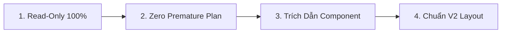

# 🔍 ERP Web Review & Technical Q&A Workflow (`/erp-review`) - Frontend

Workflow chuẩn khi người dùng muốn kiểm tra, review giao diện, phân tích component/hooks hoặc hỏi đáp kỹ thuật liên quan đến **`erp-web`** (React, Vite, TanStack Query, Ant Design / Tailwind) mà **CHƯA MUỐN LÊN PLAN & CHƯA SỬA CODE**.

---

## 🎯 Khi Nào Kích Hoạt Workflow Này

1. User hỏi về luồng render, state management, form handling hoặc custom hooks.
2. User muốn review một file Component, Page, Drawer, Modal hoặc API Client Hook.
3. User muốn kiểm tra nguyên nhân bug giao diện (lệch CSS, mất state, fetch loop, filter không ăn, form validation không chạy).
4. Thảo luận chuẩn hóa giao diện theo Design System V2 trước khi bắt tay vào làm.

---

## 🛡️ 4 Nguyên Tắc Cốt Lõi (Core Principles)



1. **🔒 Read-Only 100%**:
   - Sử dụng các công cụ đọc mã nguồn (`view_file`, `grep_search`, `find_by_name`).
   - **TUYỆT ĐỐI KHÔNG** sửa component, không chạy build/test sinh artifact, không commit/push.
2. **🛑 Zero Premature Plan**:
   - **KHÔNG TỰ Ý** tạo `implementation_plan.md`, `walkthrough.md` hay danh sách task chi tiết (`X.Y.Z`).
   - Đi thẳng vào phân tích giao diện và giải đáp thắc mắc.
   - Chỉ chuyển sang lập kế hoạch khi người dùng yêu cầu rõ ràng (ví dụ: *"OK, lên plan đi"* hoặc gõ `/erp-plan`).
3. **📌 Dẫn Chứng Trực Tiếp Từ Mã Nguồn (Evidence-First)**:
   - Luôn trích dẫn chính xác file component và dòng code (ví dụ `[src/modules/...#L30-L55]`).
   - Đối chiếu với hợp đồng API thực tế xem response data có khớp với TypeScript interface không.
4. **💡 Tuân Thủ Chuẩn Layout & Design Tokens**:
   - Kiểm tra đối chiếu với các nguyên tắc UI chuẩn của Liouni:
     - `SpreadsheetPageTemplate`: Header Filter, STT 1-based, pagination.
     - `StandardFormDrawer`: Kích thước theo đơn vị `vw` (không hardcode `px`).
     - i18n: Không hardcode chuỗi hiển thị tiếng Việt.

---

## 📋 Checklist Đánh Giá Frontend Web

- [ ] **Component Structure**: Có phân tách rõ Presentation Component và Container/Hook logic không?
- [ ] **Data Fetching**: Dùng TanStack Query với caching / invalidation hợp lý; không dùng `useEffect` gọi API thủ công gây waterfall/race condition.
- [ ] **Design Tokens**: Tuân thủ bảng màu chuẩn của dự án; không dùng class màu tùy tiện.
- [ ] **Form Handling**: Form validation với schema chuẩn; xử lý loading/disabled states khi submit.
- [ ] **Responsive & Sizing**: Drawer dùng `vw`, table scroll ngang/dọc mượt mà.
- [ ] **TypeScript Strict**: Đầy đủ Props Interface; không lạm dụng `any`.

---

## 💬 Định Dạng Phản Hồi

```markdown
### 1. Phân tích hiện trạng / Trả lời
[Giải thích ngắn gọn, đi thẳng vào câu hỏi hoặc vấn đề UI/State của User]

### 2. Dẫn chứng mã nguồn (Evidence)
- File `[erp/erp-web/src/...#L...]`: [Component hoặc Hook liên quan]
- Điểm bất thường / Rủi ro (nếu có): [Render loop / mất type safety / layout vỡ...]

### 3. Đề xuất phương án cải thiện
- **Phương án 1 (Khuyến nghị)**: [Mô tả + Ưu điểm theo chuẩn V2]
- **Phương án 2 (Thay thế)**: [Mô tả + Hạn chế]

---
*(Chờ phản hồi từ User trước khi chuyển sang lập Plan triển khai)*
```
