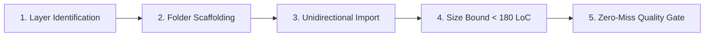
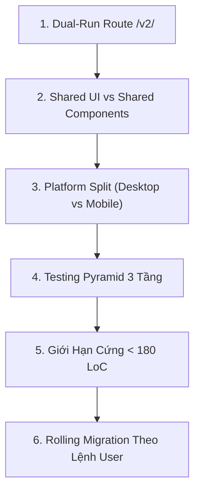

# 🏗️ ERP Web Structure Workflow (`/ui-structure`)

Workflow gộp ba phần cấu trúc frontend. **Phần A** dùng khi tạo mới hoặc tách component UI theo Atomic 5 tầng. **Phần B** dùng khi migrate module V1 sang V2 (`src/v2/`). **Phần C** dùng khi làm bảng hoặc drawer. Playbook, quy ước và checklist nằm ở skill `erp-web-structure`.

Chọn phần: tạo mới hoặc tách component trong V1/shared thì làm Phần A. Migrate module sang `/v2/` thì làm Phần B, và chỉ khi user ra lệnh. Làm bảng hoặc drawer thì làm Phần C. Cả ba phần đều phải qua audit của Phần A.

---

## 🅰️ Phần A: Atomic 5 tầng (V1 và V2)

Workflow này hướng dẫn Developer và Agent quy trình chuẩn 5 giai đoạn khi **tạo mới**, **chia tách file lớn (> 180 LoC)** hoặc **refactor kiến trúc** bất kỳ thành phần giao diện nào trong `erp-web` theo đúng **5 Tầng Atomic Design (Brad Frost) kết hợp Domain-Driven Design (DDD)**.

---

### 🎯 4 Nguyên Tắc Sống Còn (Core Directives)



1. **Phân Tầng Tuyệt Đối**: Mọi UI component phải thuộc chính xác 1 trong 5 tầng (`Atoms`, `Molecules`, `Organisms`, `Templates`, `Pages`). Không có component "vô thừa nhận" hoặc dồn đống trong `shared`.
2. **Import Một Chiều (Top-Down)**: `Templates > Organisms > Molecules > Atoms`. Tầng cao import tầng thấp. **CẤM** import ngược dòng. **CẤM** import ngang hàng cùng cấp trong cùng một scope.
3. **Folder-per-Component (`kebab-case`)**: Mỗi component có 1 thư mục riêng, file chính `PascalCase.tsx`, các file vệ tinh chuẩn số ít (`.hook.ts`, `.state.ts`, `.type.ts`, `.schema.ts`, `.helper.ts`, `.test.tsx`, `index.ts`).
4. **Giới Hạn Cứng < 180 LoC & Co-located Test**: Không file nào vượt quá 180 dòng. Test nằm ngay bên cạnh component (co-located).

---

### 🧭 Quy Trình 5 Giai Đoạn Chuẩn (5-Phase SOP)

#### 🔹 GIAI ĐOẠN 1: Xác Định Tầng Atomic (Layer Identification)

Trước khi viết bất kỳ dòng code nào, hãy đối chiếu component cần xây dựng/refactor với **Cây Quyết Định (Decision Tree)**:

```
Component của bạn thuộc nhóm nào?
├── 1. Pure UI Primitive, stateless, props-driven, 0% logic nghiệp vụ?
│   └── 👉 Level 1: ATOMS (@/shared/components/atoms hoặc modules/[mod]/components/atoms)
│       Ví dụ: Button, Badge, StatusDot, RequiredIndicator, NeutralCountBadge, TableDateCell, Icons.
│
├── 2. Cụm tương tác nhỏ, chỉ quản lý Local UI State (useState/useRef), 0% API, 0% Store?
│   └── 👉 Level 2: MOLECULES (@/shared/components/molecules hoặc modules/[mod]/components/molecules)
│       Ví dụ: PillTabs, Combobox, TableText, SubtotalSummaryCell, FilterChips, TableColumnHeaderFilter.
│
├── 3. Khối UI phức hợp hoàn chỉnh, có kết nối API, React Query, RBAC, Form validation?
│   └── 👉 Level 3: ORGANISMS (@/shared/components/organisms hoặc modules/[mod]/components/organisms)
│       Ví dụ: StandardTable, StandardFormDrawer, ConfirmModal, FilterPanel, [Module]Table, [Module]DetailDrawer.
│
├── 4. Khung xương bố cục trang/bảng/drawer mẫu chưa gắn dữ liệu nghiệp vụ cụ thể?
│   └── 👉 Level 4: TEMPLATES (@/shared/components/templates)
│       Ví dụ: SpreadsheetPageTemplate, DashboardTemplate, PageWithTabsLayout.
│
├── 5. Màn hình hoàn chỉnh gắn với URL route, tích hợp Template + Organisms?
│   └── 👉 Level 5: PAGES (@/modules/[mod]/pages hoặc @/pages)
│       Ví dụ: InvoicesPage, InventoryStockPage, GarageCasesPage.
│
└── 6. Không chứa JSX (Types, Constants, Shared Hooks, Utility Functions)?
    └── 👉 NON-UI FOUNDATIONS (@/shared/types, constants, hooks, utils hoặc module-level)
```

---

#### 🔹 GIAI ĐOẠN 2: Khởi Tạo Thư Mục Chuẩn (`kebab-case/` Scaffolding)

Mỗi component **BẮT BUỘC** nằm trong một thư mục riêng biệt theo định dạng `kebab-case`. Bóc tách các file vệ tinh theo đúng quy ước số ít:

```
[component-name]/
├── [ComponentName].tsx            # Component TSX chính (< 150 LoC)
├── [ComponentName].hook.ts        # Hook xử lý logic (< 180 LoC)
├── [ComponentName].state.ts       # State khởi tạo, draft, reducer (nếu có, < 100 LoC)
├── [ComponentName].type.ts        # TypeScript props, interfaces (< 80 LoC)
├── [ComponentName].schema.ts      # Zod validation schema (nếu có form, < 80 LoC)
├── [ComponentName].helper.ts      # Parsers, formatters nội bộ (< 100 LoC)
├── [ComponentName].stories.tsx    # Co-located Storybook Stories (bắt buộc cho shared/v2)
├── [ComponentName].test.tsx       # Co-located Unit Test bắt buộc
└── index.ts                       # Public barrel export: export * from "./[ComponentName]";
```

##### 🧠 Ranh Giới Hook Theo Tầng:
- **Tại Atoms (L1) & Molecules (L2)**:
  - Chỉ được phép chứa **Pure UI Logic Hooks** (`useState`, `useRef`, keyboard navigation, popover toggle, animation).
  - **TUYỆT ĐỐI CẤM**: Không gọi API, không dùng `@tanstack/react-query`, không kết nối Global Zustand Store.
- **Tại Organisms (L3)**:
  - Được phép chia thành 2 hook riêng nếu phức tạp:
    - `[Name].ui.hook.ts`: UI toggles, active tabs, expand/collapse state.
    - `[Name].biz.hook.ts` hoặc `[Name].hook.ts`: React Query mutations, REST API calls, RBAC permission checks, form submit.

##### 🏷️ Quy Ước Tên Hook (H1–H4)
- **H1**: tên hàm luôn bắt đầu bằng `use` (bắt buộc của React).
- **H2 — Hook gắn với một component, drawer hoặc page**: file `[Component].hook.ts` đặt cạnh component, export `use[Component]`. Khi tách nhỏ dùng `[Component].data.hook.ts` (tải dữ liệu), `.ui.hook.ts` (trạng thái giao diện), `.biz.hook.ts` (hành động, submit).
- **H3 — Hook độc lập, dùng lại (query, mutation, hook dùng chung, store)**: file `use<Tên>.ts`, đặt trong `api/queries/`, `api/mutations/`, `hooks/`, `stores/`.
- **H4**: file hook không chứa JSX nên đuôi `.ts`. Cần JSX thì tách phần JSX sang helper `.tsx`.
- Tên file phụ trợ dùng số ít: `.type.ts`, không dùng `.types.ts`.

---

#### 🔹 GIAI ĐOẠN 3: Kiểm Soát Chiều Import & Ràng Buộc Phụ Thuộc

> [!IMPORTANT]
> **QUY TẮC BẤT DI BẤT DỊCH: `TEMPLATES (L4) > ORGANISMS (L3) > MOLECULES (L2) > ATOMS (L1)`**

| Caller (Thành phần gọi) | Gọi Atom (`L1`) | Gọi Molecule (`L2`) | Gọi Organism (`L3`) | Gọi Template (`L4`) | Gọi Shared Non-UI | Gọi Ngang Cấp Cùng Scope | Gọi Ngang Cấp Sang Shared |
| :--- | :---: | :---: | :---: | :---: | :---: | :---: | :---: |
| **Page** (`L5`) | ✅ | ✅ | ✅ | ✅ | ✅ | ⚠️ Tránh | ✅ |
| **Template** (`L4`) | ✅ | ✅ | ✅ | ❌ CẤM | ✅ | ❌ CẤM | ✅ |
| **Organism (Shared)** (`L3`) | ✅ | ✅ | ❌ CẤM | ❌ CẤM | ✅ | ❌ CẤM | — |
| **Organism (Module)** (`L3`) | ✅ | ✅ | ❌ CẤM (Module) | ❌ CẤM | ✅ | ❌ CẤM (Module) | ✅ Cho phép (Shared Org) |
| **Molecule (Shared)** (`L2`) | ✅ | ❌ CẤM | ❌ CẤM | ❌ CẤM | ✅ | ❌ CẤM | — |
| **Molecule (Module)** (`L2`) | ✅ | ❌ CẤM (Module) | ❌ CẤM | ❌ CẤM | ✅ | ❌ CẤM (Module) | ✅ Cho phép (Shared Mol) |
| **Atom (Shared)** (`L1`) | ❌ CẤM | ❌ CẤM | ❌ CẤM | ❌ CẤM | ✅ Types/Utils | ❌ CẤM | — |
| **Atom (Module)** (`L1`) | ❌ CẤM | ❌ CẤM | ❌ CẤM | ❌ CẤM | ✅ Types/Utils | ❌ CẤM (Module) | ✅ Cho phép (Shared Atom) |

*Cách giải quyết khi 2 component cùng cấp cần dùng nhau:*
- Cần kết hợp 2 `Atoms` $\rightarrow$ Tạo 1 `Molecule` để compose.
- Cần kết hợp 2 `Molecules` $\rightarrow$ Tạo 1 `Organism` để compose.
- Cần dùng chung logic/state $\rightarrow$ Trích xuất ra `hooks/` hoặc `utils/` dùng chung.

---

#### 🔹 GIAI ĐOẠN 4: Khống Chế Kích Thước File (< 180 LoC) & Phân Tách Non-UI

Khi một file component tiến gần mốc 150-180 dòng, thực hiện phân tách theo thứ tự ưu tiên:
1. **Bước 1 - Tách Type Contract**: Trích xuất toàn bộ `interface`, `type`, `Props` ra `[ComponentName].type.ts`.
2. **Bước 2 - Tách Hook Logic**: Đưa toàn bộ `useState`, `useEffect`, `useCallback`, `useQuery` ra `[ComponentName].hook.ts`.
3. **Bước 3 - Tách Helper / Formatting**: Đưa các hàm format ngày, số, mapping status ra `[ComponentName].helper.ts`.
4. **Bước 4 - Tách Sub-components**: Nếu bên trong có render các khối con phức tạp, tạo các sub-components riêng trong cùng folder hoặc đưa về đúng tầng Atomic (`Atoms` / `Molecules`).

---

#### 🔹 GIAI ĐOẠN 5: Zero-Miss Quality Gate & Co-located Testing

Trước khi kết thúc task refactor hoặc code mới, Developer / Agent **BẮT BUỘC** thực hiện quy trình kiểm duyệt 2 bước:

##### 1. Viết Co-located Unit Test (`.test.tsx`):
- Nằm cùng cấp bên trong folder component: `[ComponentName].test.tsx`.
- Tối thiểu phải test được:
  - Component render không bị crash.
  - Hiển thị đúng props truyền vào.
  - Các tương tác cơ bản (click toggle, nhập input, hiển thị tooltip).

##### 2. Chạy Bộ Lệnh Grep Audit CLI Bắt Buộc:

```bash
# 1. Quét kiểm tra vi phạm No Blue Mandate (Phải trả về 0 kết quả)
grep -rn "blue-" src/modules/[target-module]/components/

# 2. Quét kiểm tra hardcode text không qua i18n
grep -rn 'title="[A-ZÀ-Ỹa-zà-ỹ]' src/modules/[target-module]/components/

# 3. Quét vi phạm giới hạn kích thước file > 180 LoC
wc -l src/modules/[target-module]/components/*/*/*

# 4. Quét vi phạm import ngược dòng (Organisms import Templates)
grep -rn "templates/" src/modules/[target-module]/components/organisms/

# 5. Chạy Type Check & Co-located Tests
bun run type:check
bun run test src/modules/[target-module]/components/

# 6. Kiểm tra Storybook Build (nếu thuộc shared/v2)
bun run build-storybook
```

---

### 🔁 Hướng v2-ready (refactor v1 để migrate v2 dễ hơn)

Áp dụng khi chạm module v1 (track T1 trong `/erp-plan`). Phần lõi sau refactor phải copy sang `src/v2/modules/<m>/` được mà không viết lại.

| Việc | Làm ở v1 bây giờ | Đích khi migrate v2 |
| :--- | :--- | :--- |
| Logic nghiệp vụ thuần (không React, store, axios) | file thuần trong `utils/` hoặc `[Name].helper.ts` | `domain/rules/` |
| Gọi API | hook query/mutation riêng `use<X>Query.ts` / `use<X>Mutation.ts` | `api/queries/`, `api/mutations/` |
| Props, type | `[Name].type.ts` | y hệt |
| Component | folder-per-component, < 180 LoC, test co-located | y hệt, thêm `.desktop/.mobile` (chỉ ở v2) |

Quy tắc:
- **Không** làm platform split `.desktop/.mobile` ở v1; đó là bước của v2.
- Lập **danh sách tính năng màn hình** ngay trong plan (tính năng, file v1, trạng thái). Đây là bảng parity khi migrate.
- Module đã migrate sang v2: không refactor v1 nữa, chuyển sang `/ui-structure`.
- v1 chưa đụng tới và > 180 dòng là **legacy**, không bắt buộc refactor. Ngưỡng 180 bắt buộc với code mới và code được refactor.

Đường dẫn v1 và v2:

| Loại | v1 | v2 |
| :--- | :--- | :--- |
| Component của module | `src/modules/<m>/components/` | `src/v2/modules/<m>/components/` |
| Shared component | `src/shared/components/` | `src/v2/shared/components/` |
| Shadcn primitive | — | `src/v2/shared/ui/` |

### 📋 Checklist Kiểm Tra Hoàn Thành (Atomic DoD)

- [ ] **Đúng Tầng Atomic**: Xác định chuẩn xác component thuộc Level 1, 2, 3, 4 hay 5.
- [ ] **Mỗi Component 1 Folder**: Toàn bộ component nằm trong thư mục `kebab-case/` riêng có `index.ts`.
- [ ] **Đặt Tên Chuẩn Số Ít**: File chính `PascalCase.tsx`, các file đi kèm chuẩn số ít (`.hook.ts`, `.state.ts`, `.type.ts`, `.schema.ts`, `.helper.ts`, `.stories.tsx`, `.test.tsx`).
- [ ] **Ranh Giới Hook Chuẩn**: Atoms & Molecules CHỈ chứa Pure UI Hook (0% API/Store). Organisms chứa Business Logic Hooks.
- [ ] **Import Một Chiều**: Không có import ngược dòng (`Templates > Organisms > Molecules > Atoms`) và không import ngang hàng cùng cấp.
- [ ] **Giới Hạn File**: 100% các file đều $< 180\text{ LoC}$.
- [ ] **No Blue Mandate**: Tuyệt đối không còn class `blue-*` nào trong mã nguồn giao diện.
- [ ] **i18n 100%**: Tất cả user-facing text bọc trong `t(...)` có fallback tiếng Việt và đồng bộ VI/EN.
- [ ] **Co-located Stories**: Có file `[ComponentName].stories.tsx` đối với shared/v2 components, render độc lập không phụ thuộc V1.
- [ ] **Co-located Test**: File `[ComponentName].test.tsx` nằm trực tiếp cùng cấp trong folder.
- [ ] **Type Check & Test Pass**: `bun run type:check` 0 lỗi, unit test pass 100% và `bun run build-storybook` thành công.


---

## 🅱️ Phần B: Migrate V1 → V2 (`src/v2/`)

Tài liệu này là quy trình tác nghiệp tiêu chuẩn (SOP) dành cho Kỹ sư và AI Agent khi **thiết lập nền tảng v2** và **di chuyển cuốn chiếu (Rolling Migration)** các module trong `erp-web` sang kiến trúc `src/v2/`.

---

### 🎯 6 Nguyên Tắc Bất Di Bất Dịch (Core Mandates)



1. **Dual-Run Route `/v2/` Song Song Tuyệt Đối**:
   - Route `/v2/*` và `/` (V1) chạy song song trên cùng một Vite server và bundle.
   - Chia sẻ hoàn toàn Auth state (`useAuthStore`) và Axios HTTP client từ V1. Không dựng Bridge Adapter trung gian.
2. **Phân Định Rõ Ràng Thư Mục Shared & Quy Tắc Import 1 Chiều**:
   - `src/v2/shared/ui/<component>/`: Thư viện primitive từ Shadcn/UI (Button, Dialog, Popover, Select...). Mỗi component tổ chức theo chuẩn **Folder-per-Component** (gồm `<component>.tsx`, `<component>.test.tsx`, `index.ts`), kèm master barrel export `src/v2/shared/ui/index.ts`. Thêm component mới thông qua lệnh `bun run ui:add <name>`.
   - `src/v2/shared/components/`: Các UI components chuẩn hệ sinh thái Atomic Design (Atoms, Molecules, Organisms, Templates).
   - **Quy tắc Import 1 Chiều Bắt Buộc (Unidirectional Dependency)**: Các component trong cấu trúc Atoms, Molecules ĐƯỢC PHÉP import từ `shared/ui` của Shadcn UI (`@/v2/shared/ui`) và wrap/custom lại cho phù hợp dự án. **TUYỆT ĐỐI CẤM CHIỀU NGƯỢC LẠI** (`shared/ui` không bao giờ import từ `atoms`, `molecules`, `organisms` hay bất kỳ tầng nào cao hơn).
3. **Component-Driven Development (Storybook) & V2 Theme Cô Lập**:
   - Mọi Shared Component trong `src/v2/shared/components/` và `src/v2/shared/ui/` bắt buộc phải có file Storybook co-located: `[ComponentName].stories.tsx`.
   - **Hệ thống Theme V2 độc lập**: Cấu hình theme riêng biệt tại `src/v2/shared/styles/` (`v2-theme.css`, `index.css`) và `src/v2/shared/theme/` (`applyV2Theme`, 4 themes: `Default`, `Classic`, `OrcaQ`, `Midnight`), không phụ thuộc theme V1.
   - **Storybook Scope Cô Lập Tuyệt Đối**: `.storybook/main.ts` chỉ quét `src/v2/**/*.stories.*`, `.storybook/preview.tsx` chỉ import `@/v2/shared/styles/index.css`. Storybook kết nối độc lập với V2 Theme Toolbar và V2 Locale Toolbar.
4. **Platform Split (Desktop vs Mobile) Phân Cấp Cây Giao Diện**:
   - Tách rời giao diện bằng component tree độc lập: `[Name].desktop.tsx` và `[Name].mobile.tsx`.
   - File entry `[Name].tsx` là **Switcher thuần túy (< 15 LoC)**, dùng `useViewport()` hook để render variant tương ứng.
   - **Bắt buộc áp dụng**: Layouts, Drawers (Desktop: Slide từ phải 65vw; Mobile: Bottom Sheet), Modals, Pages có trải nghiệm khác biệt.
5. **Testing Pyramid 3 Tầng Toàn Diện**:
   - **Unit Tests**: Co-located ngay cạnh source file (`[Name].test.ts` / `[Name].test.tsx`). Test pure business rules trong `domain/rules/`, test component state, test hooks.
   - **Integration Tests**: Đặt tại `src/v2/modules/<name>/tests/integration/` nhằm test tương tác Form -> Validate -> Mutation -> Table Refresh.
   - **E2E Tests**: Đặt tại `src/v2/tests/e2e/` chạy trên browser thật kiểm tra trọn vẹn luồng nghiệp vụ tại `/v2/*`.
6. **Kỷ Luật Code Cứng (ngưỡng dòng theo tầng, No Blue Mandate, 100% i18n)**:
   - Ngưỡng theo mục *Ngưỡng kích thước* bên dưới: cảnh báo ở **180 LoC**, chặn ở **250 LoC** với `.tsx` và `.hook.ts`. Vượt 180 phải lên kế hoạch tách `.hook.ts`, `.helper.ts`, sub-components; vượt 250 không được merge.
   - Loại trừ file dữ liệu và cấu hình thuần (`*.locale.ts`, `*.options.ts`, `*.config.ts`, `*.type.ts`, `*.data.ts`). Các file này không tính vào ngưỡng.
   - Cấm dùng màu `blue-*` của Tailwind mặc định. Bắt buộc dùng bảng màu HSL ngữ cảnh (`var(--primary)`, `var(--accent)`, `var(--muted)`...).
   - Cấm hardcode text thô trong JSX. Bắt buộc 100% qua `t('...')` (i18n VI/EN).
7. **Rolling Migration Tuân Thủ Triệt Để Lệnh Của User**:
   - Agent **TUYỆT ĐỐI KHÔNG** tự ý bắt đầu migrate bất kỳ module nào nếu chưa có lệnh rõ ràng từ User.
   - Mỗi module migrate độc lập, verify 100% Quality Gate trước khi báo cáo kết quả và dừng lại chờ lệnh tiếp theo.

### 🧱 Kỷ Luật Atomic (tham chiếu `/ui-structure`)

Áp dụng cho mọi file UI trong `src/v2/` và cho các file V1 được chạm trong task. Chi tiết và lệnh audit nằm ở `ui-structure.md`; mục này là bộ tối thiểu bắt buộc khi làm việc với `src/v2/`:

- **Phân tầng**: mỗi component thuộc đúng một tầng (Atoms, Molecules, Organisms, Templates, Pages).
- **Import một chiều**: `Templates > Organisms > Molecules > Atoms`. Cấm import ngược tầng và import ngang hàng cùng tầng. Khi hai organism cần chung một phần, đưa phần đó xuống molecule hoặc truyền qua props/slot từ tầng cha.
- **Ranh giới hook**: Atoms và Molecules chỉ nhận props, không gọi API, React Query hay store. Logic nghiệp vụ nằm trong hook của Organisms.
- **Cấu trúc thư mục**: folder-per-component kebab-case, có `index.ts`, test co-located (`.test.tsx`).
- **Quy tắc chung cho mọi họ nghiệp vụ (áp dụng cho tất cả module V2, không có ngoại lệ theo module)**: UI, rule, hook controller và locale của một họ nằm ở `src/v2/core/<họ-nghiệp-vụ>/` (ví dụ `core/goods-receipts/`), mô hình giống `src/v2/core/` của API v2. Mọi module thuộc họ đó (ví dụ `modules/garage-goods-receipts/`) chỉ giữ phần riêng: API client và DTO, cấu hình ghép core (`<module>.config.ts`), locale tiêu đề và nút tạo, page và permission.
  - **Core là nơi mặc định**: khi bắt đầu một module mới trong họ đã có core, dùng core trước. Khi bắt đầu họ mới, tạo `core/<họ>/` ngay từ đầu, không viết logic chung vào module rồi chờ tách sau.
  - **Chiều phụ thuộc**: `modules/* → core/* → shared/`. `core/*` **không** import từ `modules/*`. Module không import module khác. Không chứa tên module cụ thể (ví dụ "garage") trong core.
  - **Core không gắn namespace module**: nhãn đi qua `t()` với khóa `v2.<họ>.*` riêng của core (đăng ký bằng `registerV2ModuleLocale`). Component core nhận `t` và cấu hình (`config`) qua prop.
  - **Import qua barrel, không import sâu**: module và core import họ phiếu qua `@/v2/core/<họ>` và shared qua `@/v2/shared/components` (hoặc barrel cấp `atoms`/`molecules`/`organisms`/`templates`), không đi vào file con như `@/v2/core/<họ>/hooks/...` hay `@/v2/shared/components/atoms/v2-button`. Bên trong `shared/` giữ import tương đối hoặc sâu để tránh vòng lặp. Mỗi folder component phải có `index.ts` export đủ.
  - **Module chỉ khác nhau ở cấu hình**: khác biệt giữa các module của cùng họ (endpoint, khóa cache, quyền, cột bổ sung, trường bắt buộc) đi qua object cấu hình được inject vào core, không sao chép code.
  - **Generic UI không thuộc họ nào** (ví dụ button, modal, bảng generic) vẫn ở `shared/`, không đưa vào core.
- **Ngưỡng kích thước**: cảnh báo ở 180 dòng cho `[Name].tsx` và `.hook.ts`, chặn ở 250 dòng. `.type.ts` < 80, `.helper.ts` < 100. Loại trừ file dữ liệu/cấu hình thuần (xem mục 6 Core Mandates). Vượt ngưỡng thì tách theo thứ tự type → hook → helper → sub-component.
- **Cấm hardcode**: chuỗi hiển thị đi qua `t()`; cấm màu `blue-*`.
- **Trước khi báo xong**: chạy audit ở Giai đoạn 5 của `ui-structure.md`, type-check, và test của thư mục đã chạm.

---

### 🧭 Cây Thư Mục Tiêu Chuẩn `src/v2/`

```
src/v2/
├── app/                                    # Root Application Shell V2
│   ├── App.tsx                             # Entry point v2 (Lazy-loaded từ src/App.tsx)
│   ├── layouts/
│   │   ├── V2AppLayout.tsx                 # Switcher (< 15 LoC)
│   │   ├── V2AppLayout.desktop.tsx         # Sidebar + Header Desktop
│   │   └── V2AppLayout.mobile.tsx          # Bottom Navigation + Header Mobile
│   ├── providers/
│   │   └── index.tsx                       # Gom bọc QueryClient, ThemeProvider, Toast
│   └── router/
│       ├── v2Routes.tsx                    # Định nghĩa toàn bộ routes con của /v2/*
│       └── guards/                         # AuthGuard, PermissionGuard
│
├── core/                                   # UI, rule và hook dùng chung theo họ nghiệp vụ (giống src/v2/core của API v2)
│   └── <họ>/                               # Ví dụ goods-receipts/ (phiếu nhập)
│       ├── domain/                         # Kiểu, rule validate/dirty, tính tiền, hằng số
│       ├── api/                            # keys, interface API, query và mutation dùng chung
│       ├── components/                     # molecules (badge), organisms (form, bảng, lines editor)
│       ├── drawers/                        # Drawer chung của họ + hook dữ liệu/hành vi
│       ├── hooks/                          # hook controller màn danh sách
│       ├── <họ>.config.type.ts             # Kiểu cấu hình module inject vào core
│       ├── <họ>.locale.ts                  # Khóa v2.<họ>.*
│       └── index.ts
│
├── shared/                                 # Tài sản dùng chung toàn bộ V2
│   ├── styles/                             # Hệ thống CSS & theme độc lập V2
│   │   ├── v2-theme.css                    # Biến màu 4 themes (Default, Classic, OrcaQ, Midnight)
│   │   └── index.css                       # Master V2 stylesheet (@tailwind + focus reset)
│   ├── theme/                              # Quản lý theme V2
│   │   ├── v2Theme.type.ts                 # Type V2Theme ('default' | 'classic' | 'orcaq' | 'midnight')
│   │   ├── v2ThemeHelper.ts                # applyV2Theme toggle class documentElement
│   │   ├── v2ThemeHelper.test.ts
│   │   └── index.ts
│   ├── ui/                                 # Shadcn/ui Primitives (Folder-per-component)
│   │   ├── button/                         # button.tsx, button.stories.tsx, button.test.tsx, index.ts
│   │   ├── badge/                          # badge.tsx, badge.stories.tsx, badge.test.tsx, index.ts
│   │   └── index.ts                        # Master Barrel Export (export * from './button'...)
│   ├── components/                         # Atomic Design Components (Import 1 chiều từ shared/ui)
│   │   ├── atoms/                          # L1: V2Button, V2Text, V2NavIcon, V2SidebarIcon (kèm *.stories.tsx)
│   │   ├── molecules/                      # L2: V2Topbar, V2Breadcrumb, V2TabItem, V2NavItem (kèm *.stories.tsx)
│   │   ├── organisms/                      # L3: V2Sidebar, V2TabBar, V2Header, V2RightPanel (kèm *.stories.tsx)
│   │   └── templates/                      # L4: SpreadsheetPageTemplate, DashboardTemplate
│   ├── hooks/                              # useViewport, useDebounce, usePermission
│   │   ├── useViewport.ts
│   │   └── useViewport.test.ts
│   └── utils/                              # Formatter, calculations, helpers
│
└── modules/                                # Các Module Nghiệp Vụ Kebab-case
    └── [module-name]/                      # Ví dụ: sales-orders/, erp-invoices/
        ├── domain/                         # Pure Business Logic (0% React/JSX)
        │   ├── entities/                   # Interface dữ liệu nghiệp vụ
        │   │   └── sales-order.entity.ts
        │   ├── rules/                      # Business Rules kèm Co-located Unit Tests
        │   │   ├── can-deliver-order.ts
        │   │   └── can-deliver-order.test.ts
        │   └── value-objects/              # Money, OrderStatus, VinNumber
        │
        ├── api/                            # Data Fetching & Mutations
        │   ├── queries/                    # useSalesOrdersQuery.ts
        │   ├── mutations/                  # useCreateSalesOrderMutation.ts
        │   └── dtos/                       # Request/Response DTO types
        │
        ├── components/                     # Atomic UI của riêng module
        │   ├── atoms/
        │   │   └── sales-status-badge/
        │   │       ├── SalesStatusBadge.tsx
        │   │       ├── SalesStatusBadge.type.ts
        │   │       ├── SalesStatusBadge.test.tsx
        │   │       └── index.ts
        │   ├── molecules/
        │   └── organisms/
        │       └── sales-order-table/
        │           ├── SalesOrderTable.tsx         # Switcher
        │           ├── SalesOrderTable.desktop.tsx # Bảng đầy đủ cột, pagination, filter
        │           ├── SalesOrderTable.mobile.tsx  # Card list + infinite scroll
        │           ├── SalesOrderTable.hook.ts
        │           ├── SalesOrderTable.type.ts
        │           ├── SalesOrderTable.test.tsx
        │           └── index.ts
        │
        ├── drawers/                        # Platform-split bắt buộc tại Drawers
        │   ├── SalesOrderDetailDrawer.tsx          # Switcher (< 15 LoC)
        │   ├── SalesOrderDetailDrawer.desktop.tsx  # Drawer trượt từ phải (65vw)
        │   ├── SalesOrderDetailDrawer.mobile.tsx   # Bottom Sheet trượt từ đáy
        │   └── SalesOrderDetailDrawer.hook.ts
        │
        ├── pages/                          # L5: Pages (Switcher Pattern)
        │   ├── SalesOrderListPage.tsx              # Switcher: isMobile ? Mobile : Desktop
        │   ├── SalesOrderListPage.desktop.tsx      # SpreadsheetPageTemplate + Table + Drawer
        │   └── SalesOrderListPage.mobile.tsx       # MobilePageTemplate + Card List + Bottom Sheet
        │
        └── tests/                          # Integration Tests cấp Module
            └── integration/
                └── create-sales-order.integration.test.tsx
```

---

### 🧭 Quy Trình 5 Giai Đoạn Chuẩn

#### 🔹 GIAI ĐOẠN 1: Khởi Tạo Nền Tảng (Scaffolding & Routing)
1. **Thiết lập Path Alias**:
   - Thêm alias `@/v2/*` trỏ tới `src/v2/*` trong cả `tsconfig.json` và `vite.config.ts`.
2. **Khai Báo Dispatcher Route `/v2/`**:
   - Trong `src/App.tsx`, bọc kiểm tra nếu URL bắt đầu bằng `/v2` thì lazy-load mount `src/v2/app/App.tsx`.
   - Nếu không bắt đầu bằng `/v2`, toàn bộ router V1 chạy bình thường 100%.
3. **App Shell V2**:
   - Tạo `src/v2/app/App.tsx` kèm providers (TanStack Query, Toast, Theme).
   - Kiểm tra đăng nhập qua `useAuthStore` từ V1: nếu chưa đăng nhập redirect về `/login`, đã đăng nhập render `V2AppLayout`.

#### 🔹 GIAI ĐOẠN 2: Xây Dựng Shared Core & Viewport Engine
1. **Cài Đặt Hook `useViewport()`**:
   - Đặt tại `src/v2/shared/hooks/useViewport.ts`.
   - Breakpoints:
     - `isMobile`: `< 768px`
     - `isTablet`: `768px - 1023px` (xem như Mobile layout nếu không có thiết kế riêng)
     - `isDesktop`: `≥ 1024px`
   - Bắt buộc có co-located unit test `useViewport.test.ts`.
2. **Scaffold `shared/ui/`**:
   - Nhúng các Shadcn primitives cần thiết (`button.tsx`, `dialog.tsx`, `sheet.tsx`, `popover.tsx`...).
3. **Scaffold `shared/components/`**:
   - Khởi tạo 4 tầng: `atoms/`, `molecules/`, `organisms/`, `templates/`.
   - Tuân thủ chiều import đơn hướng: `Templates (L4) > Organisms (L3) > Molecules (L2) > Atoms (L1)`.

#### 🔹 GIAI ĐOẠN 3: Triển Khai Module Scaffolding & Pure Domain Rules
0. **Sinh khung bằng plop (ưu tiên)**: chọn generator theo bảng dưới (đồng bộ với `api-structure` Phần B). Sau đó chạy `bunx prettier --write src/v2/modules/<module>` hoặc `src/v2/core/<họ>`. Chi tiết tham số: skill `plop-generate`.

   | Tình huống | Generator | Kết quả |
   | :--- | :--- | :--- |
   | Họ nghiệp vụ mới, chưa có lõi | `v2-core` (nhập họ, entity) | `src/v2/core/<họ>/`: config type, API type, keys, domain, locale, barrel, `core.manifest.json` với `exports: null` |
   | Lõi họ đã viết xong hook UI | Khai báo `exports` trong `core.manifest.json` | Cho phép ghép module mỏng |
   | Module thuộc họ đã có lõi | `v2-thin-module` (chọn lõi, nhập tiêu đề vi/en, route, nhóm menu, bật wire) | `src/v2/modules/<module>/`: config, API, locale, page + hook, index, test tích hợp; khi wire tự nối route, menu, i18n vi/en và page registry |
   | Entity đơn lẻ, không thuộc họ | `v2-module` | Module standalone đầy đủ |
   | Module V1 cũ | `table-page`, `drawer`, `modal`, `table-section` | `[LEGACY-V1]`, chỉ giữ để tham khảo |

   Quy tắc: họ mới luôn tạo lõi (`v2-core`) trước, viết hook UI của lõi rồi khai báo `exports`, sau đó mới ghép module mỏng. `v2-thin-module` từ chối lõi chưa khai báo `exports` và báo lỗi rõ ràng.
1. **Khởi tạo thư mục module `kebab-case/`** (nếu không dùng plop):
   - `domain/entities/`, `domain/rules/`.
2. **Đưa Business Logic về Domain Rules**:
   - Viết các quy tắc nghiệp vụ dưới dạng pure TypeScript functions, 0% React/JSX/Hooks.
   - Viết Co-located Unit Tests (`*.test.ts`) kiểm tra 100% case biên (< 5ms/test).
3. **Tách riêng Data Access Layer**:
   - Đặt queries tại `api/queries/use[Module]Query.ts`.
   - Đặt mutations tại `api/mutations/use[Module]Mutation.ts`.
4. **Đối chiếu V1 trước khi viết** (bắt buộc khi migrate): liệt kê feature trong module V1 và lập bảng parity theo playbook mục 5 của skill `erp-web-structure`.
5. **Module V1 đã refactor v2-ready** (logic thuần và hook query/mutation tách riêng, xem `ui-structure`): bước 2–3 chỉ còn đối chiếu và chuyển sang `src/v2/modules/<m>/`. Cập nhật mục "Trạng thái migrate" của skill sau khi xong.

#### 🔹 GIAI ĐOẠN 4: Platform Split & UI Assembly
1. **Áp dụng Switcher Pattern cho Layouts, Drawers, Modals, Pages**:
   - File entry `[ComponentName].tsx` làm Switcher tối giản (< 15 LoC):
   ```tsx
   import React from 'react';
   import { useViewport } from '@/v2/shared/hooks/useViewport';
   import { SalesOrderTableDesktop } from './SalesOrderTable.desktop';
   import { SalesOrderTableMobile } from './SalesOrderTable.mobile';

   export const SalesOrderTable: React.FC = () => {
     const { isMobile } = useViewport();
     return isMobile ? <SalesOrderTableMobile /> : <SalesOrderTableDesktop />;
   };
   ```
2. **Desktop Variant (`*.desktop.tsx`)**:
   - Hiển thị bảng dạng Spreadsheet/Data Table nhiều cột, sticky headers, top action bar, drawer từ phải (65vw).
3. **Mobile Variant (`*.mobile.tsx`)**:
   - Hiển thị danh sách thẻ card vuốt chạm, scroll pagination, bottom sticky action bar, bottom sheet kéo từ dưới lên.
4. **Co-located Testing**:
   - Viết unit test cho component Desktop và Mobile tương ứng.

#### 🔹 GIAI ĐOẠN 5: Zero-Miss Quality Gate & Grep Audit Suite
Trước khi hoàn tất bất kỳ module nào, chạy toàn bộ bộ lệnh kiểm toán tự động:

```bash
# 1. Quét vi phạm No Blue Mandate (Phải trả về 0 kết quả)
grep -rn "blue-" src/v2/modules/[target-module]/

# 1b. Không import V1 (chỉ authStore được phép) và mọi key dịch có tiền tố v2.
grep -rnE "from \"@/(core|shared|modules|pages|components)/" src/v2/modules/[target-module] --include="*.ts" --include="*.tsx" | grep -vE "\.test\.|\.stories\.|authStore"
grep -rnP "\bt\(\s*\"(?!v2\.)[a-zA-Z]+\.[A-Za-z.]+\"" src/v2/modules/[target-module] --include="*.ts" --include="*.tsx"

# 2. Quét vi phạm kích thước file (> 180 LoC)
find src/v2/modules/[target-module]/ -name "*.tsx" -o -name "*.ts" | xargs wc -l | awk '$1 > 180 {print}'

# 3. Quét vi phạm hardcode text tiếng Việt không qua i18n
grep -rn '>[A-ZÀ-Ỹa-zà-ỹ0-9 ]*<' src/v2/modules/[target-module]/

# 4. Kiểm tra Type-check toàn dự án
cd erp/erp-web && bunx tsc --noEmit

# 5. Chạy toàn bộ Unit Tests của module
cd erp/erp-web && bun run test src/v2/modules/[target-module]/

# 6. Kiểm tra Storybook CDD & Build tĩnh V2
cd erp/erp-web && bun run build-storybook
# Khởi chạy Storybook dev server (:6006)
cd erp/erp-web && bun run storybook
```

---

## 🅲 Phần C: Table & Drawer

Mỗi loại có một skill duy nhất (đã gồm V1, V2 và phần phụ) và một workflow chi tiết. Bảng chọn đầy đủ nằm ở mục 3 của skill `erp-web-structure`.

| Việc | Skill (đọc trước) | Workflow chạy | Reference |
| :--- | :--- | :--- | :--- |
| Trang bảng, cột, filter, subtotal, bảng nhúng (V1) | `standardize-table` | [`/standardize-table`](./standardize-table.md) (5 giai đoạn, kèm bộ grep audit) | `references/table-page.md`, `references/table-rules.md` |
| Bảng hoặc trang dưới `src/v2/` | `standardize-table` | [`/standardize-table`](./standardize-table.md) | `references/v2-table.md` |
| Drawer chi tiết hoặc form (V1) | `standardize-drawer` | [`/standardize-drawer`](./standardize-drawer.md) (4 bước) | `references/drawer-rules.md` |
| Drawer dưới `src/v2/` | `standardize-drawer` | [`/standardize-drawer`](./standardize-drawer.md) | `references/v2-drawer.md` |
| Tab chứng từ liên kết, cấn trừ, truy vết | `standardize-drawer` | [`/standardize-drawer`](./standardize-drawer.md) | `references/drawer-rules.md` mục 11 |

Đường dẫn reference đầy đủ: `.agents/skills/<skill>/references/<file>`.

Quy tắc: làm theo workflow của loại tương ứng, sau đó chạy audit của Phần A (No Blue, i18n, giới hạn 180 dòng, import ngược). Với V2, chạy thêm audit ở Phần B mục "Zero-Miss Quality Gate".

---

## 🅳 Phần D: Enum cho Field nhập liệu & Option dùng chung

Mục tiêu: mỗi key field và mỗi bộ option (trạng thái, phương thức thanh toán, loại đối tượng…) chỉ khai báo một lần, để form, bảng và filter thống nhất và tái sử dụng được.

### Quy tắc
1. **Không dùng chuỗi cứng** cho key field hoặc option lặp lại: khai báo `export enum`.
2. **Vị trí enum**:
   - Chỉ dùng trong một module: `<module>.enum.ts` cạnh file config field (mẫu: `src/modules/garage/components/organisms/garage-cashflow-drawer/garageCashflowDrawer.enum.ts`).
   - Dùng từ hai module trở lên: `src/shared/` (V1) hoặc `src/v2/shared/types/` (V2). Có thể gộp vào file types sẵn có (`v2-status.ts`, `v2-tab-mode.ts`, `v2-drawer-mode.ts`) nếu đúng ngữ nghĩa.
3. **Option = enum + map nhãn**: một map duy nhất `Record<Enum, string>` với nhãn qua `t()`. Không lặp nhãn ở nhiều nơi.
4. **Form**: key field lấy từ enum (`name: MyFieldKey.AMOUNT`) và cấu hình theo mảng config với `V2FormGrid` (xem `standardize-drawer/references/drawer-rules.md`). Option của select/radio lấy từ map ở mục 3, không khai báo mảng inline.
5. **Tái sử dụng**: field hoặc option dùng chung import từ một nguồn, không sao chép sang file khác.
6. **Bảng và filter**: khi cùng ý nghĩa với field form, dùng chung enum và map nhãn.

### Audit (áp dụng cho file đã tạo hoặc đã chạm)
```bash
# 1. Key field viết chuỗi cứng trong file config form (kỳ vọng: 0 kết quả)
grep -rnE "name: ['\"][a-zA-Z_]+['\"]" src --include='*.fields.ts' --include='*.fields.tsx'

# 2. Mảng option khai báo inline trong component (nên chuyển sang enum + map)
grep -rnE "options: \[\s*\{" src --include='*.tsx' --include='*.ts' | grep -v '\.test\.'
```
Kết quả còn lại phải được giải thích trong walkthrough hoặc đưa vào enum trước khi báo xong.
